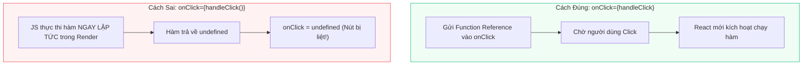
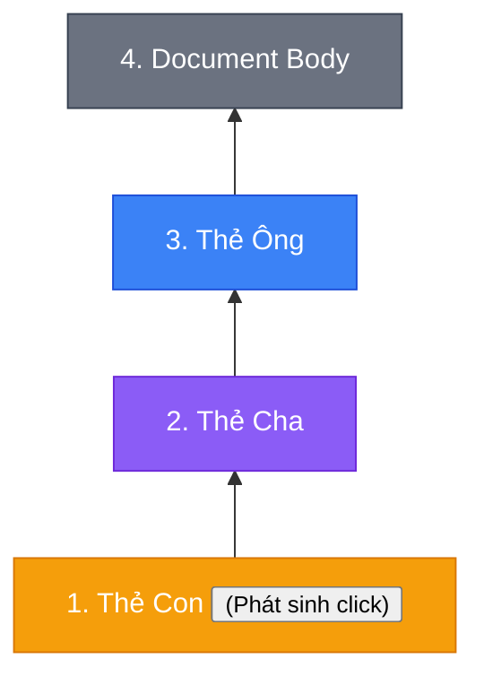

# **BÀI HỌC 10: RESPONDING TO EVENTS (PHẢN HỒI SỰ KIỆN)**

> **Hành trình: Zero to Hero React**  
> **Chủ đề:** Làm chủ cơ chế xử lý sự kiện trong React: Truyền hàm vs Thực thi hàm, Event Bubbling, `stopPropagation()`, `preventDefault()`, và truyền Handler qua Props.  
> **Tài liệu tham khảo chính thức:** [React.dev - Responding to Events](https://react.dev/learn/responding-to-events)

---

## 🌟 TỔNG QUAN BÀI HỌC

Trong React, giao diện của bạn không chỉ để ngắm mà là một hệ thống sống động tương tác hai chiều với người dùng. **Event Handler** là chiếc cầu nối tiếp nhận hành động của người dùng (click, hover, submit, gõ phím) và kích hoạt logic cập nhật State hoặc gọi API.

Hiểu sâu về cơ chế xử lý sự kiện giúp bạn:
1. **Tránh lỗi phổ biến nhất của người mới học:** Phân biệt rạch ròi giữa **Truyền hàm (`onClick={handleClick}`)** và **Gọi hàm ngay lúc render (`onClick={handleClick()}`)**.
2. **Kiểm soát luồng sự kiện (Event Flow):** Làm chủ cơ chế **Sủi bọt sự kiện (Event Bubbling)** và biết chính xác khi nào cần dùng `e.stopPropagation()`.
3. **Xây dựng Single-Page Application (SPA) mượt mà:** Hiểu bản chất của `e.preventDefault()` để chặn hành vi reload trang truyền thống của trình duyệt, bảo toàn trạng thái ứng dụng.
4. **Thiết kế Component linh hoạt (Design System):** Truyền hàm xử lý từ component cha xuống component con qua Props với tên gọi tùy biến theo ngữ cảnh nghiệp vụ.

---

## 1. BẢN CHẤT: HÀM XỬ LÝ SỰ KIỆN (EVENT HANDLER) TRONG REACT

### 1.1. Định nghĩa và Quy ước
- **Event Handler:** Là hàm do bạn định nghĩa để phản hồi các tương tác của người dùng.
- **Vị trí khai báo:** Thường được định nghĩa **bên trong** thân Component.
- **Quy ước đặt tên:** Bắt đầu bằng từ `handle` + Tên sự kiện viết hoa chữ cái đầu (ví dụ: `handleClick`, `handleMouseEnter`, `handleSubmit`).
- **Gắn vào JSX:** Truyền trực tiếp định nghĩa hàm vào prop sự kiện của thẻ JSX (ví dụ: `onClick={handleClick}`).

### 1.2. Ba cú pháp định nghĩa Event Handler
```jsx
// Cách 1: Định nghĩa hàm riêng (Khuyên dùng khi logic từ 2 dòng trở lên)
export default function Button() {
  function handleClick() {
    alert('Đã click nút!');
  }
  return <button onClick={handleClick}>Bấm vào tôi</button>;
}

// Cách 2: Định nghĩa Inline ẩn danh (Anonymous Function)
<button onClick={function handleClick() {
  alert('Đã click!');
}}>Bấm vào tôi</button>

// Cách 3: Định nghĩa Inline bằng Arrow Function (Gọn gàng nhất cho tác vụ 1 dòng)
<button onClick={() => alert('Đã click!')}>Bấm vào tôi</button>
```

---

## 2. CẠM BẪY CHÍ MẠNG: TRUYỀN HÀM (PASS) VS THỰC THI HÀM (CALL)

Đây là cạm bẫy số 1 khiến 90% người mới học React gặp lỗi nút bấm bị liệt hoặc component tự chạy lung tung khi vừa tải trang!

| Tiêu chí | Truyền hàm - ĐÚNG (Pass a function) | Gọi hàm ngay lập tức - SAI (Call a function) |
|:---|:---|:---|
| **Cú pháp** | `<button onClick={handleClick}>` | `<button onClick={handleClick()}>` |
| **Inline Cú pháp** | `<button onClick={() => alert('Hi')}>` | `<button onClick={alert('Hi')}>` |
| **Bản chất** | Truyền **tham chiếu hàm (Function Reference)** | **Thực thi hàm ngay lập tức** trong Pha Render |
| **Thời điểm chạy** | Chỉ chạy khi người dùng **thực sự click chuột** | Chạy ngay khi màn hình vừa tải xong |
| **Hậu quả khi sai** | Hoạt động chính xác theo tương tác | Nút bị liệt vì `onClick` nhận giá trị trả về (`undefined`) thay vì nhận hàm! |



---

## 3. TRUYỀN EVENT HANDLER TỪ CHA XUỐNG CON QUA PROPS

Trong các Design System chuyên nghiệp, các component cơ sở như nút bấm chỉ nên lo phần giao diện (style bo góc, màu sắc, bóng đổ), còn **hành vi cụ thể sẽ do Component cha quyết định và truyền xuống qua Props**:

```jsx
// Component Con: Nhận hàm từ cha và gắn vào thẻ button thật
function Button({ onClick, children }) {
  return (
    <button onClick={onClick} className="btn-base">
      {children}
    </button>
  );
}

// Component Cha: Quyết định logic khác nhau cho từng nút
export default function Toolbar() {
  return (
    <div>
      <Button onClick={() => alert('Đang phát phim!')}>
        Play Movie
      </Button>
      <Button onClick={() => alert('Đang tải ảnh!')}>
        Upload Image
      </Button>
    </div>
  );
}
```

### Quy ước đặt tên Prop cho Event Handler tự tạo:
- Thẻ HTML gốc (`<button>`, `<div contentEditable>`) bắt buộc phải dùng tên sự kiện trình duyệt như `onClick`, `onMouseEnter`.
- Với Component do bạn tự định nghĩa, bạn có thể đặt tên prop tùy biến, bắt đầu bằng `on` + chữ hoa:
  - `<Button onSmash={handleClick} />`
  - `<Toolbar onPlayMovie={...} onUploadImage={...} />`

---

## 4. CƠ CHẾ SỦI BỌT SỰ KIỆN (EVENT PROPAGATION / BUBBLING)

### 4.1. Bản chất của Event Bubbling
Trong cây DOM, khi một sự kiện xảy ra trên thẻ con (ví dụ nút bấm), sự kiện đó sẽ **sủi bọt (bubble) ngược lên trên qua tất cả các thẻ cha chứa nó**, kích hoạt lần lượt các handler `onClick` của từng thẻ cấp trên.

> ℹ️ **Ngoại lệ:** Duy nhất sự kiện `onScroll` không sủi bọt trong React.

```jsx
<div onClick={() => alert('Click Thẻ Cha (Toolbar)!')}>
  <button onClick={() => alert('Click Nút Con (Button)!')}>
    Bấm vào tôi
  </button>
</div>
```
- Khi bạn click vào `<button>`, màn hình sẽ hiện liên tiếp **2 thông báo**:
  1. `'Click Nút Con (Button)!'` (từ chính nút bấm).
  2. `'Click Thẻ Cha (Toolbar)!'` (do sự kiện lan truyền lên thẻ `<div>` cha).



### 4.2. Ngăn chặn lan truyền với `e.stopPropagation()`
Hàm handler luôn nhận tham số đầu tiên là **đối tượng sự kiện (SyntheticEvent `e`)**. Để dừng không cho sự kiện lan lên các thẻ cha:

```jsx
function Button({ onClick, children }) {
  return (
    <button onClick={(e) => {
      e.stopPropagation(); // ⛔ Dừng lan truyền tại đây!
      onClick();
    }}>
      {children}
    </button>
  );
}
```

---

## 5. NGĂN CHẶN HÀNH VI MẶC ĐỊNH VỚI `e.preventDefault()`

### 5.1. Hành vi mặc định (Default Behavior) của trình duyệt là gì?
- **Thẻ `<form>`:** Khi bấm Submit hoặc ấn Enter, trình duyệt sẽ tự động gom form và **tải lại (F5) toàn bộ trang web**.
- **Thẻ `<a>`:** Tự động chuyển hướng URL và reload trang.

### 5.2. Tại sao reload trang lại là thảm họa trong Single Page Application (SPA)?
1. **Mất sạch dữ liệu trong RAM (State):** Toàn bộ State tạm thời trong bộ nhớ của React sẽ bị reset về ban đầu.
2. **Trải nghiệm gián đoạn:** Màn hình bị chớp trắng, mất công gõ form dở dang của người dùng.
3. **Hủy ngang request:** Yêu cầu gọi API ngầm (fetch/axios) chưa kịp hoàn tất đã bị trình duyệt hủy do reload trang.

### 5.3. Sử dụng `e.preventDefault()` đúng chuẩn:
```jsx
export default function SignupForm() {
  function handleSubmit(e) {
    e.preventDefault(); // ⛔ Chặn reload trang mặc định!
    // Gửi dữ liệu ngầm bằng fetch / axios mượt mà:
    api.register({ username, password });
  }

  return (
    <form onSubmit={handleSubmit}>
      <input name="username" />
      <button type="submit">Đăng Ký</button>
    </form>
  );
}
```

### Bảng so sánh cốt lõi: `stopPropagation` vs `preventDefault`
| Phương thức | Tác dụng | Trường hợp điển hình |
|:---|:---|:---|
| **`e.stopPropagation()`** | Chặn sự kiện sủi bọt lên các thẻ cha | Bấm nút "Xóa" hoặc "Like" bên trong một hàng bảng (Row) mà không kích hoạt sự kiện click chọn cả hàng. |
| **`e.preventDefault()`** | Ngăn trình duyệt thực hiện hành vi mặc định | Chặn reload trang khi submit `<form>`, chặn nhảy link khi bấm thẻ `<a>`. |

---

## 6. 🌱 GÓC NHÌN ĐỐI CHIẾU BACKEND (JAVA / SPRING BOOT)

| Khái niệm React | Mô hình tương đương trong Java / Spring Boot | Bản chất kiến trúc |
|:---|:---|:---|
| **Event Handler Function** | **Spring `@EventListener` / Observer Pattern** | Đăng ký một hàm/phương thức để xử lý khi có tín hiệu sự kiện phát sinh. |
| **Event Bubbling** | **Servlet Filter Chain / Interceptor Chain** | Một yêu cầu đi qua từng tầng middleware từ ngoài vào trong, sau đó phản hồi ngược từ trong ra ngoài. |
| **`e.stopPropagation()`** | **Ngắt chuỗi Filter (`return` mà không gọi `chain.doFilter()`)** | Ngừng truyền tiếp Request lên các bộ lọc phía sau hoặc Controller cấp trên. |
| **`e.preventDefault()`** | **Overriding Default Servlet Handler / `@ResponseBody`** | Không để servlet container chuyển hướng trang theo mặc định, mà xử lý ngầm và trả về JSON trực tiếp. |
| **Passing Handler via Props** | **Strategy Pattern / Functional Interface (`Consumer<T>`)** | Truyền hành vi thực thi vào đối tượng dưới dạng tham số thay vì cố định logic bên trong đối tượng. |

---

## 7. 🎯 LỜI GIẢI CHI TIẾT BÀI TẬP THỬ THÁCH (REACT.DEV CHALLENGES)

### Thử thách 1: Sửa nút bấm bật tắt đèn bị liệt (Fix an event handler)
- **Lỗi gốc:** `<button onClick={handleClick()}>` đang gọi hàm ngay lúc render.
- **Cách sửa chuẩn:** Bỏ cặp ngoặc tròn `()`:
```jsx
export default function LightSwitch() {
  function handleClick() {
    let bodyStyle = document.body.style;
    if (bodyStyle.backgroundColor === 'black') {
      bodyStyle.backgroundColor = 'white';
    } else {
      bodyStyle.backgroundColor = 'black';
    }
  }

  return (
    <button onClick={handleClick}>
      Toggle the lights
    </button>
  );
}
```

### Thử thách 2: Ngăn bộ đếm số lượt click toàn trang bị tăng nhầm (Wire up the events)
- **Nguyên nhân:** Khi click nút đổi màu, sự kiện click sủi bọt lên thẻ `<div>` cha chứa hàm đếm `handleClickOutside`.
- **Cách sửa chuẩn:** Thêm `e.stopPropagation()` trước khi chạy hàm đổi màu:
```jsx
export default function ColorSwitch({ onChangeColor }) {
  return (
    <button onClick={(e) => {
      e.stopPropagation(); // ⛔ Dừng sủi bọt lên thẻ cha!
      onChangeColor();
    }}>
      Change color
    </button>
  );
}
```

---

## 8. TỔNG KẾT BÀI HỌC (RECAP)

1. Gắn hàm xử lý sự kiện vào JSX bằng cách **truyền định nghĩa hàm** (`onClick={handleClick}`), **tuyệt đối không thêm dấu ngoặc tròn `()`**.
2. Sự kiện mặc định **sủi bọt (bubble) từ dưới lên trên** dọc theo cây DOM. Dùng **`e.stopPropagation()`** để ngăn chặn.
3. Dùng **`e.preventDefault()`** để ngăn các hành vi mặc định của trình duyệt (như reload trang khi submit form).
4. Phân tách giao diện và hành vi bằng cách **truyền Event Handler từ cha xuống con qua Props**.