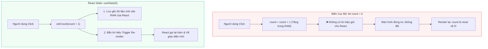
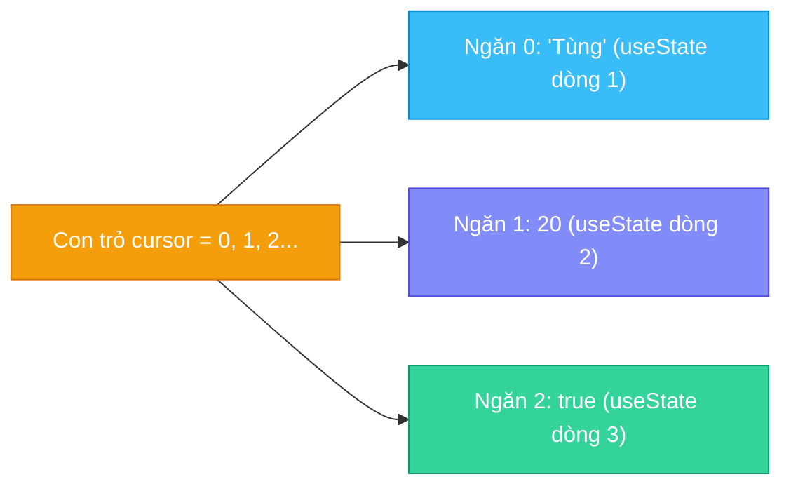

# **BÀI HỌC 11: STATE - A COMPONENT'S MEMORY (BỘ NHỚ CỦA COMPONENT)**

> **Hành trình: Zero to Hero React**  
> **Chủ đề:** Làm chủ State trong React: Tại sao biến `let` không đủ, Cú pháp `useState`, Cơ chế con trỏ mảng (Cursor) ở hậu trường, Luật tối thượng của Hooks và Tính độc lập của State.  
> **Tài liệu tham khảo chính thức:** [React.dev - State: A Component's Memory](https://react.dev/learn/state-a-components-memory)

---

## 🌟 TỔNG QUAN BÀI HỌC

Trong lập trình thông thường, một hàm sau khi thực thi xong sẽ giải phóng toàn bộ biến cục bộ khỏi bộ nhớ RAM. Tuy nhiên, các ứng dụng web tương tác cần ghi nhớ dữ liệu người dùng (ảnh đang xem, nội dung giỏ hàng, thông tin biểu mẫu dở dang) và vẽ lại màn hình mỗi khi dữ liệu đó biến đổi.

**State chính là bộ nhớ riêng tư của từng Component**. Bài học này sẽ giải phẫu:
1. **Bản chất cốt lõi:** Tại sao biến cục bộ `let` hoàn toàn vô dụng khi cần cập nhật giao diện.
2. **Cơ chế 2 bước:** Lưu giữ dữ liệu (Retain) và Kích hoạt vẽ lại (Trigger Re-render).
3. **Giải phẫu Hook `useState`:** Cú pháp Array Destructuring và ý nghĩa cặp giá trị `[state, setState]`.
4. **Bí mật dưới nắp máy (Under the hood):** Giải mã cách React quản lý State bằng **Mảng (Array) và Con trỏ chỉ số (Cursor)**, lý giải nguyên nhân cấm kỵ việc gọi Hook trong `if`, `for`.
5. **Tính độc lập & riêng tư:** Mỗi thực thể Component sở hữu một vùng nhớ độc lập hoàn toàn.
6. **Chiến lược tổ chức State:** Khi nào nên tách riêng, khi nào nên gom thành Object DTO.

---

## 1. BẢN CHẤT: TẠI SAO BIẾN CỤC BỘ (LET) LÀ KHÔNG ĐỦ?

Khi bạn muốn giao diện thay đổi sau tương tác (bấm nút Next để đổi tranh, gõ chữ vào form), việc viết `let index = 0; index = index + 1;` hoàn toàn thất bại vì **2 lý do cốt tử**:

1. **Biến cục bộ không sống sót qua các lần render (Do not persist between renders):**
   - Mỗi lần component chạy lại, hàm được thực thi lại từ dòng đầu tiên.
   - Dòng `let index = 0;` sẽ bị khởi tạo lại về 0, xóa sạch mọi thay đổi trước đó.
2. **Thay đổi biến cục bộ KHÔNG kích hoạt quá trình vẽ lại (Do not trigger re-renders):**
   - Trong JavaScript thuần, thay đổi giá trị một biến số không phát ra tín hiệu nào cho React biết để cập nhật DOM.



> 💡 **Quy tắc React:** Cập nhật giao diện cần đồng thời 2 yếu tố:
> 1. **Lưu giữ (Retain):** Dữ liệu phải sống sót qua các lần gọi hàm Component.
> 2. **Kích hoạt (Trigger):** Báo hiệu cho React gọi lại hàm Component với dữ liệu mới (Re-render).

---

## 2. CÚ PHÁP VÀ GIẢI PHẪU HOOK `useState`

Khởi tạo State bằng cách import từ React và dùng cú pháp **Array Destructuring**:

```jsx
import { useState } from 'react';

const [index, setIndex] = useState(0);
```

### Phân tích từng thành phần:
- **Tham số truyền vào (`0`):** Giá trị khởi tạo (Initial Value) của State trong lần render đầu tiên (Mounting).
- **Cặp giá trị trả về:**
  1. **Biến State (`index`):** Lưu trữ giá trị hiện tại của dữ liệu.
  2. **Hàm Setter (`setIndex`):** Cập nhật giá trị State mới VÀ kích hoạt React re-render.
- **Quy ước đặt tên (Convention):** Luôn đặt theo cặp `[something, setSomething]`.

---

## 3. VÒNG ĐỜI CẬP NHẬT STATE TỪNG BƯỚC MỘT

Xét ví dụ: `const [index, setIndex] = useState(0);`

```mermaid
sequenceDiagram
    autonumber
    actor User as Người Dùng
    participant Comp as Component
    participant React as React Engine (RAM)

    Note over Comp,React: 1. Lần Render Đầu Tiên (Mounting)
    Comp->>React: useState(0)
    React-->>Comp: Trả về [0, setIndex]
    Comp->>User: Vẽ tranh tại vị trí index = 0

    Note over User,Comp: 2. Tương tác Người Dùng
    User->>Comp: Click nút Next
    Comp->>React: Gọi setIndex(1)
    React->>React: Ghi nhớ: index = 1; Lên lịch Re-render

    Note over Comp,React: 3. Lần Render Thứ Hai (Re-render)
    React->>Comp: Gọi lại hàm Component
    Comp->>React: useState(0) (Số 0 ban đầu bị bỏ qua!)
    React-->>Comp: Trả về giá trị mới [1, setIndex]
    Comp->>User: Vẽ tranh mới tại vị trí index = 1
```

---

## 4. QUY TẮC TỐI THƯỢNG CỦA REACT HOOKS (RULES OF HOOKS)

⚠️ **LUẬT BẤT THÀNH VĂN (BẮT BUỘC TUÂN THỦ):**
1. Mọi hàm bắt đầu bằng chữ `use...` (`useState`, `useEffect`, `useContext`) đều là **Hooks**.
2. **Chỉ được gọi Hooks ở tầng ngoài cùng (Top Level)** của Component hoặc Custom Hook.
3. ❌ **TUYỆT ĐỐI CẤM:** Gọi Hooks bên trong câu lệnh điều kiện (`if/else`), vòng lặp (`for/while`), hay hàm lồng nhau (`nested functions`).

```jsx
// ❌ SAI NGHIÊM TRỌNG: Gọi hook bên trong if
if (isSent) {
  return <h1>Cảm ơn bạn!</h1>;
} else {
  const [message, setMessage] = useState(''); // 💥 Gây crash: Rendered fewer hooks than expected
}

// ✅ ĐÚNG: Luôn gọi ở tầng trên cùng trước mọi lệnh return
const [isSent, setIsSent] = useState(false);
const [message, setMessage] = useState('');

if (isSent) return <h1>Cảm ơn bạn!</h1>;
```

---

## 5. DƯỚI NẮP MÁY: LÀM SAO REACT BIẾT TRẢ VỀ ĐÚNG STATE NÀO? (THE DRAWER MODEL)

### 5.1. Dấu hỏi lớn: `useState` không hề có tên hay ID!
Hãy nhìn vào cách bạn khai báo 3 State:
```jsx
const [name, setName] = useState('Tùng');
const [age, setAge] = useState(20);
const [isLoggedIn, setIsLoggedIn] = useState(true);
```
Bạn không hề truyền tên biến vào hàm (không có `useState("name", "Tùng")`). Vậy làm sao React biết lần gọi thứ 1 là của `name`, lần 2 là của `age`, và lần 3 là của `isLoggedIn`?

### 5.2. Mô hình Ngăn Kéo & Con Trỏ (Internal Array & Cursor)
Ở hậu trường, với mỗi Component, React cấp phát một **Mảng nội bộ trong RAM** và một **biến con trỏ `cursor = 0`**:



- **Lần render thứ nhất:**
  - `cursor = 0`: Lưu `'Tùng'` vào Ngăn 0 $\rightarrow$ `cursor++`.
  - `cursor = 1`: Lưu `20` vào Ngăn 1 $\rightarrow$ `cursor++`.
  - `cursor = 2`: Lưu `true` vào Ngăn 2 $\rightarrow$ `cursor++`.
- **Lần render thứ hai:**
  - React **reset con trỏ về 0 (`cursor = 0`)**.
  - Dòng 1 gọi `useState`: React mở Ngăn 0 bốc `'Tùng'` $\rightarrow$ `cursor++` (lên 1).
  - Dòng 2 gọi `useState`: React mở Ngăn 1 bốc `20` $\rightarrow$ `cursor++` (lên 2).
  - Dòng 3 gọi `useState`: React mở Ngăn 2 bốc `true` $\rightarrow$ `cursor++` (lên 3).

### 5.3. Thảm họa khi nhét `useState` vào `if`: Lệch pha toàn bộ ngăn kéo
Nếu bạn đặt `useState(20)` trong `if (name !== '')`:
- Khi người dùng xóa trắng tên (`name = ''`), câu lệnh `if` bị bỏ qua!
- Cuộc gọi `useState(true)` của `isLoggedIn` biến thành **cuộc gọi thứ 2**.
- React tiến tới **Ngăn 1** và bốc con số **`20`** (tuổi) đưa vào biến `isLoggedIn`!
- React phát hiện số lượng Hook gọi ở lần 2 (2 Hooks) ít hơn lần 1 (3 Hooks) $\rightarrow$ Tung lỗi màn hình đỏ:  
  **`"Rendered fewer hooks than expected. This may be caused by an accidental early return statement."`**

---

## 6. TÍNH ĐỘC LẬP VÀ RIÊNG TƯ CỦA STATE (ISOLATED & PRIVATE)

- **Độc lập theo từng thể hiện (Instance):**
  - Nếu bạn render `<Gallery />` ở 2 vị trí khác nhau trên trang, mỗi component sẽ sở hữu một bộ mảng State hoàn toàn riêng biệt trong RAM.
  - Bấm Next ở Gallery 1 không làm Gallery 2 bị nhảy ảnh.
- **Riêng tư tuyệt đối:**
  - Component cha không thể đọc hay can thiệp trực tiếp vào State nội bộ của component con.
- **Đồng bộ hóa:**
  - Nếu muốn 2 component dùng chung dữ liệu, bạn phải áp dụng kỹ thuật **Nâng State lên trên (Lifting State Up)** — đưa State lên component cha chung rồi truyền xuống qua Props.

---

## 7. NHIỀU BIẾN STATE: KHI NÀO NÊN TÁCH, KHI NÀO NÊN GỘP?

| Tiêu chí | Nên TÁCH RIÊNG (`useState` độc lập) | Nên GỘP OBJECT (`useState({...})`) |
|:---|:---|:---|
| **Bản chất dữ liệu** | Các cờ logic riêng rẽ (`isOpen`, `isLoading`, `theme`) | Các thuộc tính của cùng một thực thể (Form DTO, tọa độ `{x, y}`) |
| **Tần suất thay đổi** | Thay đổi độc lập, không liên quan thời điểm của nhau | Hầu như luôn cập nhật đồng thời trong cùng một sự kiện |
| **Gửi API** | Chỉ dùng để phục vụ hiển thị giao diện cục bộ | Cần đóng gói thành một cục JSON DTO để gửi lên backend |
| **Mức độ phức tạp** | Rất ngắn gọn: gọi `setX(giá_trị_mới)` | Phải nhớ rải `...stateCũ` mỗi khi chỉ muốn cập nhật 1 trường |

---

## 8. 🌱 GÓC NHÌN ĐỐI CHIẾU BACKEND (JAVA / SPRING BOOT)

| Khái niệm React | Mô hình tương đương trong Java / Spring Boot | Bản chất kiến trúc |
|:---|:---|:---|
| **Component State** | **Stateful Session Bean / In-Memory Session Cache** | Dữ liệu gắn liền với một phiên tương tác của người dùng, tồn tại xuyên suốt nhiều request. |
| **Hook Call Order / Cursor** | **Spring IoC Bean Dependency Injection by Index/Type** | Container dựa vào metadata cố định lúc khởi tạo để tiêm đúng dependency vào đúng vị trí tham số. |
| **Grouped State Object** | **Data Transfer Object (`@RequestBody UserRegisterDTO`)** | Gom nhóm các trường liên quan thành một Model thống nhất để tiện validate và truyền tải qua mạng. |
| **State Isolation** | **Prototype Scope Beans (`@Scope("prototype")`)** | Mỗi lần yêu cầu tạo một bean mới, Spring cấp phát một thực thể độc lập với trạng thái riêng biệt. |

---

## 9. 🎯 LỜI GIẢI CHI TIẾT BÀI TẬP THỬ THÁCH (REACT.DEV CHALLENGES)

### Thử thách 1: Hoàn thiện thư viện tranh ảnh (Chặn crash và thêm nút Previous)
```jsx
let hasPrev = index > 0;
let hasNext = index < sculptureList.length - 1;

function handlePrevClick() {
  if (hasPrev) setIndex(index - 1);
}

function handleNextClick() {
  if (hasNext) setIndex(index + 1);
}
```

### Thử thách 2: Sửa form bị kẹt không gõ được chữ (Fix stuck form inputs)
- **Nguyên nhân:** Dùng `let firstName = ''` khiến giá trị bị reset về rỗng sau mỗi lần render và không kích hoạt re-render.
- **Sửa chuẩn:** Đổi sang `const [firstName, setFirstName] = useState('')` và gọi `setFirstName(e.target.value)` trong `onChange`.

### Thử thách 3: Khắc phục lỗi Crash ứng dụng do gọi Hook sai vị trí
- **Nguyên nhân:** Đặt `useState` bên trong nhánh `else`, vi phạm quy tắc gọi Hook ở Top Level.
- **Sửa chuẩn:** Đưa toàn bộ các dòng `useState` lên đầu thân component trước mọi câu lệnh điều kiện `if`.

---

## 10. TỔNG KẾT BÀI HỌC (RECAP)

1. Biến thông thường `let` không lưu giữ được giá trị qua các lần render và không kích hoạt vẽ lại màn hình.
2. `useState` cung cấp bộ nhớ lưu giữ giá trị và hàm setter để kích hoạt re-render.
3. React quản lý State bằng **thứ tự cuộc gọi cố định (Call Order Cursor)**. Tuyệt đối không gọi Hook trong `if`, `for` hay hàm lồng nhau.
4. Mỗi thể hiện Component trên màn hình sở hữu một **bộ State hoàn toàn độc lập và riêng tư**.