```mermaid
graph TD
    subgraph VirtualDiff ["React Diffing trong RAM"]
        H1Old["<h1>10:00:01</h1>"] -. "Đổi thành" .-> H1New["<h1>10:00:02</h1> (Khác biệt!)"]
        InputOld["<input />"] -. "Giữ nguyên" .-> InputNew["<input /> (Không đổi!)"]
    end

    subgraph RealDOMAction ["Thao tác trên Real DOM"]
        PatchH1["Chỉ sửa textContent của <h1>"]
        KeepInput["Giữ nguyên node <input> thật (Không giật focus, giữ nguyên chữ)"]
    end

    H1New --> PatchH1
    InputNew --> KeepInput

    style VirtualDiff fill:#eff6ff,stroke:#3b82f6
    style RealDOMAction fill:#f0fdf4,stroke:#10b981
```

# **BÀI HỌC 12: RENDER AND COMMIT (QUY TRÌNH TÍNH TOÁN VÀ GẮN GIAO DIỆN)**

> **Hành trình: Zero to Hero React**  
> **Chủ đề:** Giải phẫu chu trình đưa giao diện lên màn hình: Trigger, Render, Commit, Browser Paint; Bản chất thuật toán Diffing và Sự bảo toàn DOM Nodes.  
> **Tài liệu tham khảo chính thức:** [React.dev - Render and Commit](https://react.dev/learn/render-and-commit)

---

## 🌟 TỔNG QUAN BÀI HỌC

Trước khi một thành phần giao diện xuất hiện trên màn hình máy tính của người dùng, React phải trải qua một quy trình xử lý nội bộ nghiêm ngặt gồm 3 giai đoạn riêng biệt. Việc hiểu sâu quy trình này sẽ giúp bạn:
1. **Xóa bỏ hiểu lầm tai hại:** Phân biệt rạch ròi giữa **"Render" (hành động tính toán trong RAM)** và **"Paint" (hành động đổ màu pixel lên màn hình của trình duyệt)**.
2. **Hiểu cách React bảo toàn DOM:** Hiểu tại sao component re-render liên tục mà ô `<input>` người dùng đang gõ dở không bị mất chữ hay mất tiêu điểm (Focus).
3. **Tối ưu hóa hiệu năng:** Nắm được cơ chế **Reconciliation / Diffing** giúp React chỉ chạm vào đúng những node DOM thật sự có thay đổi.

---

## 1. ẨN DỤ NHÀ HÀNG (THE RESTAURANT ANALOGY)

Để hình dung trực quan toàn bộ quy trình, hãy tưởng tượng cách vận hành của một nhà hàng ẩm thực cao cấp:

```mermaid
graph LR
    subgraph Step1 ["Bước 1: Triggering"]
        Customer["Thực Khách (User)"] --> Order["Gọi Món / Bấm Nút (Order)"]
    end

    subgraph Step2 ["Bước 2: Rendering"]
        Order --> Waiter1["Chuyển phiếu vào Bếp"]
        Waiter1 --> Chef["Đầu Bếp (Components)"]
        Chef --> Dish["Nấu nướng, tạo JSX trong RAM"]
    end

    subgraph Step3 ["Bước 3: Committing"]
        Dish --> Waiter2["Bồi Bàn (React DOM)"]
        Waiter2 --> Table["Đặt đĩa lên bàn (Cập nhật Real DOM)"]
    end

    subgraph Step4 ["Khâu Cuối: Painting"]
        Table --> Browser["Trình Duyệt (Browser Engine)"]
        Browser --> Screen["Đổ màu Pixel lên màn hình"]
    end

    style Step1 fill:#fef3c7,stroke:#f59e0b
    style Step2 fill:#e0e7ff,stroke:#6366f1
    style Step3 fill:#dcfce7,stroke:#10b981
    style Step4 fill:#f1f5f9,stroke:#64748b
```



---

## 2. BƯỚC 1: KÍCH HOẠT MỘT LẦN RENDER (TRIGGERING A RENDER)

Chỉ có **2 lý do duy nhất** khiến một Component được kích hoạt Render:

### 2.1. Lần Render Đầu Tiên khi Khởi Động Ứng Dụng (Initial Render)
- Diễn ra khi ứng dụng web vừa tải xong trang HTML.
- Được kích hoạt bởi hàm `createRoot` kết hợp phương thức `.render(<App />)`:
```jsx
import { createRoot } from 'react-dom/client';
import App from './App';

const root = createRoot(document.getElementById('root'));
root.render(<App />);
```

### 2.2. Khi State Của Component (Hoặc Tổ Tiên Của Nó) Thay Đổi (Re-render on State Update)
- Khi người dùng tương tác và hàm setter được gọi (ví dụ `setCount(count + 1)`), React sẽ tự động đưa yêu cầu re-render vào hàng đợi (Queue a render).
- > ⚠️ **Quy tắc lan truyền:** Khi một Component cha re-render, mặc định **toàn bộ cây con cháu nằm bên dưới nó cũng sẽ được kích hoạt re-render theo**.

---

## 3. BƯỚC 2: REACT THỰC HIỆN RENDER COMPONENT (RENDERING PHASE)

### 3.1. Định nghĩa cốt tử
> 🔒 **"Rendering" KHÔNG PHẢI là vẽ điểm ảnh lên màn hình!**  
> **"Rendering" là hành động React GỌI THỰC THI CÁC HÀM COMPONENT CỦA BẠN TRONG BỘ NHỚ RAM.**

- **Lần render đầu:** React gọi hàm Component gốc (`<App />`).
- **Các lần re-render tiếp theo:** React gọi đúng hàm Component có State bị thay đổi.

### 3.2. Quá trình Đệ quy (Recursive Process)

```mermaid
graph TD
    App["1. Gọi <App />"] --> Header["2. Gọi <Header />"]
    App --> Main["3. Gọi <Main />"]
    Main --> Clock["4. Gọi <Clock />"]
    Clock --> Output["5. Trả về cấu trúc JSX: <h1>10:30:15</h1> và <input />"]

    style App fill:#3b82f6,stroke:#1d4ed8,color:#ffffff
    style Main fill:#8b5cf6,stroke:#6d28d9,color:#ffffff
    style Clock fill:#10b981,stroke:#047857,color:#ffffff
```

Nếu Component vừa gọi trả về một Component con khác, React sẽ tiếp tục đệ quy gọi hàm của Component con đó. Quá trình tiếp diễn cho đến khi chạm tới các thẻ HTML cơ bản (`<div>`, `<p>`, `<h1>`), khi React đã gom đủ bản vẽ chi tiết của toàn bộ cây giao diện mới trong RAM.



### 3.3. So sánh đối chiếu (Diffing Algorithm)
- Ở lần re-render, React đem cây Virtual DOM mới sinh ra đối chiếu với cây Virtual DOM của lần render trước.
- Thuật toán Diffing tính toán ra điểm khác biệt nhỏ nhất (Minimal Difference).

> 🔒 **Quy tắc bất biến:** Quá trình Render phải luôn là **Hàm tinh khiết (Pure Calculation)**. Không được sửa biến ngoài, không gọi API, và tuyệt đối không chọc vào DOM thật trong bước này!

---

## 4. BƯỚC 3: REACT ÁP DỤNG THAY ĐỔI VÀO DOM (COMMITTING PHASE)

Sau khi tính toán xong toàn bộ cây giao diện ở Bước 2, thư viện cầu nối `react-dom` bắt đầu thao tác với cây Real DOM thật của trình duyệt:

- **Lần render đầu tiên:** React dùng `document.createElement()` và `appendChild()` để tạo mới và gắn toàn bộ các thẻ HTML lên DOM thật.
- **Các lần re-render tiếp theo:**
  - **React CHỈ can thiệp vào đúng các Node DOM thật sự có thay đổi!**
  - Những thẻ nào không thay đổi, React **giữ nguyên vẹn 100%**, không hủy, không tạo lại.

### 4.1. Minh chứng kinh điển: Chiếc đồng hồ nhảy giờ và ô `<input>`
Xét component đồng hồ đếm giây kết hợp một ô nhập liệu:

```jsx
export default function Clock({ time }) {
  return (
    <>
      <h1>{time}</h1>
      <input placeholder="Gõ thử chữ vào đây..." />
    </>
  );
}
```



- **Kết quả thực tế:** Dù `time` thay đổi và component chạy lại mỗi giây 1 lần, bạn gõ chữ vào ô `<input>` chữ vẫn còn nguyên, con trỏ nhấp nháy không bị giật, vì React **không hề đụng chạm hay tạo lại node DOM của thẻ `<input>`**!

---

## 5. KHÂU CUỐI: TRÌNH DUYỆT VẼ LÊN MÀN HÌNH (BROWSER PAINT)

- Sau khi React cập nhật xong các node trong Real DOM ở bước Commit, quyền điều khiển được trao lại cho Trình duyệt web.
- Trình duyệt thực hiện:
  1. **Layout / Reflow:** Tính toán lại vị trí, kích thước tọa độ các phần tử.
  2. **Repaint:** Đổ màu các điểm ảnh (pixels) lên màn hình cho mắt người dùng nhìn thấy.

---

## 6. 🌱 GÓC NHÌN ĐỐI CHIẾU BACKEND (JAVA / SPRING BOOT)

| Khái niệm React | Mô hình tương đương trong Java / Spring Boot | Bản chất kiến trúc |
|:---|:---|:---|
| **Render $\rightarrow$ Commit Pipeline** | **Spring MVC Request Pipeline** | `DispatcherServlet` nhận request (Trigger) $\rightarrow$ `Controller` tính toán Model & View trong RAM (Render) $\rightarrow$ Ghi dữ liệu ra `HttpServletResponse` output stream (Commit). |
| **Virtual DOM Diffing** | **Hibernate / JPA Dirty Checking Mechanism** | Khi cập nhật Entity, Hibernate so sánh snapshot ban đầu với snapshot hiện tại lúc `flush()`. Nó chỉ sinh lệnh SQL `UPDATE` cho đúng những cột có thay đổi, tránh ghi đè toàn bộ hàng trong Database! |
| **Purity in Render Phase** | **Idempotent / Stateless Service Methods** | Các hàm xử lý tính toán nghiệp vụ không gây side effect, đảm bảo gọi nhiều lần với cùng input cho ra cùng kết quả. |
| **Commit Phase Mutation** | **Database Transaction Commit (`@Transactional`)** | Gom tất cả các thay đổi hợp lệ trong RAM rồi thực hiện một lượt ghi xuống đĩa cứng / Real DOM. |

---

## 7. 🎯 BỘ CÂU HỎI PHỎNG VẤN CHUYÊN SÂU (INTERVIEW Q&A)

### Câu 1: Sự khác biệt bản chất giữa Render Phase và Commit Phase trong React là gì?
**Trả lời:**
- **Render Phase:** Diễn ra hoàn toàn trong bộ nhớ RAM. React gọi hàm component để lấy bản vẽ JSX, đệ quy duyệt cây và chạy thuật toán Diffing để tìm điểm khác biệt. Giai đoạn này là thuần túy tính toán (pure calculation) và chưa hề chạm tới DOM thật của trình duyệt.
- **Commit Phase:** Diễn ra đồng bộ (synchronous). React mang các điểm khác biệt nhỏ nhất đã tính toán ở Render Phase và áp dụng trực tiếp lên cây Real DOM của trình duyệt (thông qua `react-dom`).

### Câu 2: Tại sao việc Component re-render liên tục không làm mất trạng thái của thẻ `<input>` thuần bên trong nó?
**Trả lời:**
Bởi vì ở bước Commit, React áp dụng thuật toán Reconciliation/Diffing. Khi React so sánh cây JSX cũ và mới, nó nhận thấy thẻ `<input>` vẫn giữ nguyên loại thẻ (tag type) và cấu trúc, nên React quyết định **tái sử dụng nguyên vẹn node DOM thật đó** và chỉ cập nhật các thuộc tính nếu có thay đổi. Do node DOM thật không bị xóa hay tạo lại, tiêu điểm (Focus), trạng thái con trỏ và đoạn chữ dở dang do trình duyệt quản lý được bảo toàn 100%.

### Câu 3: Strict Mode của React kích hoạt gọi Component 2 lần ở giai đoạn nào? Render hay Commit?
**Trả lời:**
Ở **Render Phase**. Trong môi trường phát triển (Development Mode), React Strict Mode chủ động gọi hàm Component hai lần liên tiếp trong RAM để phát hiện các đoạn mã gây đột biến biến bên ngoài (Impure Side Effects). Tuy nhiên, bước Commit Phase chỉ diễn ra đúng một lần duy nhất với kết quả của lần render thứ hai.

---

## 8. TỔNG KẾT BÀI HỌC (RECAP)

1. Mọi sự thay đổi giao diện đều trải qua 3 bước: **Trigger $\rightarrow$ Render $\rightarrow$ Commit**, sau đó trình duyệt thực hiện **Paint**.
2. **Render** là quá trình gọi hàm Component để tính toán trong RAM; **Commit** là quá trình áp dụng điểm khác biệt vào DOM thật.
3. React chỉ thay đổi các node DOM thật sự có điểm khác biệt, bảo toàn nguyên vẹn các node DOM còn lại.
4. Pha Render phải luôn tinh khiết (Pure); các tác vụ Side Effects chỉ được thực hiện trong Event Handlers hoặc `useEffect`.