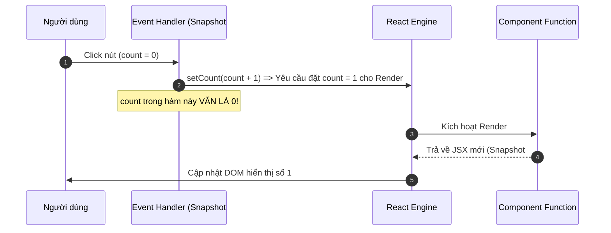
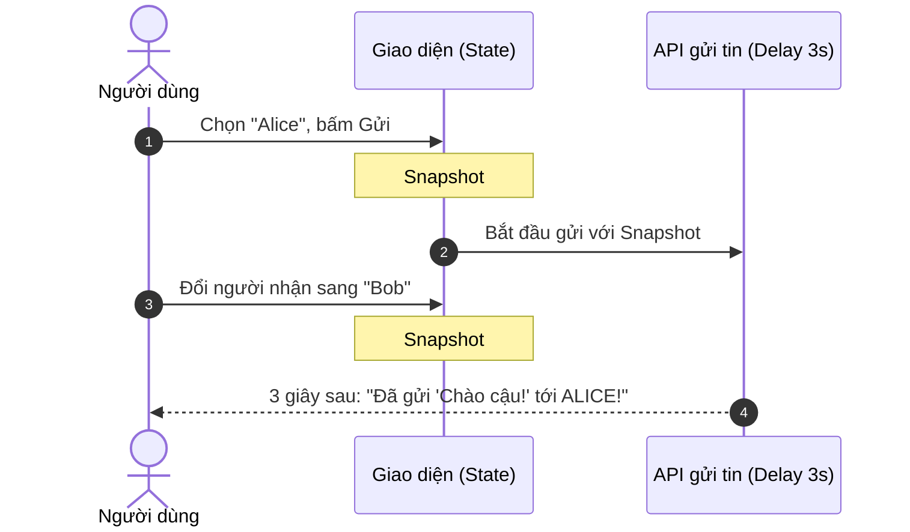

# **BÀI HỌC 13: STATE AS A SNAPSHOT (STATE NHƯ MỘT BỨC ẢNH CHỤP NHANH)**

> **Hành trình: Zero to Hero React**  
> **Chủ đề:** Bản chất bất biến của State trong mỗi chu kỳ Render; Phương pháp thế giá trị (Substitution Method); Cơ chế Closure và giải pháp chống lỗi chạy đua thời gian (Race Conditions).  
> **Tài liệu tham khảo chính thức:** [React.dev - State as a Snapshot](https://react.dev/learn/state-as-a-snapshot)

---

## 🌟 TỔNG QUAN BÀI HỌC

Trong các ngôn ngữ lập trình truyền thống (C++, Java, Python) hay biến thông thường trong JavaScript, khi bạn gán lại giá trị cho một biến (`x = x + 1`), biến đó lập tức thay đổi giá trị ngay ở dòng lệnh tiếp theo. 

Tuy nhiên, **State trong React KHÔNG hoạt động như vậy!**

Khi mới học React, rất nhiều lập trình viên rơi vào bẫy tư duy:
```javascript
const [count, setCount] = useState(0);

function handleClick() {
  setCount(count + 1);
  console.log(count); // "Ủa? Sao vẫn in ra 0 mà không phải 1?"
}
```

Bản chất cốt lõi: **State trong React hoạt động giống như một Bức Ảnh Chụp Nhanh (Snapshot)**. Mỗi lần render, React cung cấp cho Component của bạn một bức ảnh đóng băng tất cả các giá trị State tại đúng thời điểm đó.

---

## 1. BẢN CHẤT: KHÁI NIỆM "SNAPSHOT" TRONG REACT

### 1.1 Render nghĩa là gì trong ngữ cảnh của Snapshot?
1. **Render là một lời gọi hàm**: Khi State thay đổi, React gọi hàm Component của bạn một lần nữa.
2. **Trả về một bức ảnh JSX**: JSX mà hàm của bạn trả về chính là bản thiết kế giao diện (UI Snapshot) tại thời điểm đó.
3. **Props, State và Event Handlers đều thuộc về bức ảnh đó**: Khi React gọi hàm, các biến `props`, `state` và các hàm con bên trong component đều được "khóa cứng" giá trị tương ứng với lần render đó.



> [!IMPORTANT]
> **Quy tắc vàng:** Việc gọi hàm `setCount(...)` **KHÔNG** làm thay đổi biến `count` của lần render hiện tại. Nó chỉ có một nhiệm vụ duy nhất: **Gửi yêu cầu tới React để chuẩn bị một bức ảnh Snapshot mới cho lần render tiếp theo**.

---

## 2. THÍ NGHIỆM KINH ĐIỂN: TẠI SAO GỌI `setNumber(number + 1)` 3 LẦN MÀ CHỈ TĂNG 1?

Hãy phân tích đoạn mã nguồn kinh điển gây sốc cho hầu hết người mới:

```jsx
import { useState } from 'react';

export default function Counter() {
  const [number, setNumber] = useState(0);

  return (
    <button onClick={() => {
      setNumber(number + 1);
      setNumber(number + 1);
      setNumber(number + 1);
    }}>+3</button>
  );
}
```

### 2.1 Hiện tượng
* Người dùng kỳ vọng: Bấm nút thì `0 -> 3`.
* **Thực tế xảy ra:** Bấm nút, số trên màn hình chỉ tăng lên **`1`**!

### 2.2 Giải thích bằng "Phương pháp thế giá trị" (Substitution Method)
Ở lần render đầu tiên, `number` đang là `0`. Vì `number` là bất biến trong suốt lần render này, toàn bộ sự kiện click tương đương với việc bạn thay thế biến `number` bằng giá trị `0`:

```javascript
// Bản chất những gì React nhìn thấy khi bạn click:
<button onClick={() => {
  setNumber(0 + 1); // "React ơi, lần render tới hãy đổi number thành 1"
  setNumber(0 + 1); // "React ơi, lần render tới hãy đổi number thành 1"
  setNumber(0 + 1); // "React ơi, lần render tới hãy đổi number thành 1"
}}>
```

Cả 3 dòng lệnh đều đọc giá trị từ cùng một bức ảnh (`number = 0`). Bạn chỉ đang lặp lại 3 lần cùng một lời dặn dò: *"Lần render sau hãy đưa giá trị 1 vào biến number"*.

---

## 3. STATE ĐÓNG BĂNG THEO THỜI GIAN (STATE OVER TIME & CLOSURES)

🔒 **ĐỊNH LUẬT BẤT BIẾN:**  
**Giá trị của biến State KHÔNG BAO GIỜ THAY ĐỔI trong phạm vi của một lần render**, bất kể code bên trong Event Handler là đồng bộ hay bất đồng bộ (chạy với `setTimeout`, `Promise`, `fetch`, hay `async/await`).

### 3.1 Thí nghiệm 1: `alert` ngay sau khi gọi `setNumber`
```javascript
setNumber(number + 5);
alert(number); // Vẫn hiển thị 0!
```
* **Lý do:** Tại bức ảnh hiện tại, `number` là `0`. `setNumber(5)` chỉ xếp hàng yêu cầu cho lần render tới.

### 3.2 Thí nghiệm 2: `alert` nằm trong `setTimeout` 3 giây
```javascript
<button onClick={() => {
  setNumber(number + 5);
  setTimeout(() => {
    alert(number); // 3 giây sau, alert hiện ra số MẤY?
  }, 3000);
}}>+5 và hiện thông báo</button>
```
* **Kịch bản:** Khi bạn bấm nút, màn hình lập tức re-render và hiển thị số `5`. 
* Nhưng 3 giây sau, hộp thoại `alert` bật lên: **Nó hiển thị số 0 hay số 5?**
* **Đáp án:** **Số 0!**

#### Tại sao lại như vậy? (Cơ chế Closure trong JavaScript)
Khi hàm callback của `setTimeout` được khởi tạo, nó tạo ra một **JavaScript Closure**. Closure này "bắt giữ" (capture) và đóng băng giá trị của `number` tại đúng thời điểm bức ảnh đó được chụp (`number = 0`).

Dù 3 giây sau, React Engine ngoài kia đã chạy tiếp Render #2 và vẽ số `5` lên màn hình, thì hàm callback trong hàng đợi Web APIs của trình duyệt vẫn giữ nguyên biến `number` từ Snapshot #1 quá khứ.

---

## 4. LỢI ÍCH KIẾN TRÚC: CHỐNG LỖI CHẠY ĐUA THỜI GIAN (RACE CONDITIONS)

Cơ chế Snapshot không phải là một sự phiền toái, mà là một **tính năng bảo vệ kiến trúc tối thượng** của React.

### 4.1 Kịch bản: Ứng dụng Chat gửi tin nhắn trễ 3 giây
Hãy tưởng tượng bạn có ứng dụng gửi tin nhắn:
1. Người dùng chọn người nhận là **"Alice"**.
2. Người dùng gõ tin nhắn "Chào cậu!" và bấm nút **"Gửi"** (hệ thống có độ trễ mạng 3 giây).
3. Trong 3 giây đó, người dùng lập tức chuyển danh bạ sang **"Bob"** để chuẩn bị nhắn tin tiếp.



* **Nếu State là biến Mutable (thay đổi ngay tại chỗ như Vue 2 hoặc biến toàn cục):**  
  Khi 3 giây trôi qua, hàm gửi tin nhắn đọc giá trị người nhận hiện tại trên màn hình $\rightarrow$ Tin nhắn vốn gửi cho Alice sẽ **bị gửi nhầm sang cho Bob**! Đây là lỗi bảo mật và rò rỉ dữ liệu cực kỳ nguy hiểm.
* **Với React State Snapshot:**  
  Hàm gửi tin nhắn của Snapshot #1 đã bắt cứng `{ to: 'Alice' }`. Dù bạn có đổi màn hình sang Bob, tin nhắn vẫn đến chính xác người bạn đã chọn lúc bấm nút.

---

## 5. BẢNG SO SÁNH TƯ DUY: BIẾN MUTABLE VS REACT STATE SNAPSHOT

| Tiêu chí | Biến thông thường (`let x = 0`) | Biến State (`const [x, setX] = useState(0)`) |
| :--- | :--- | :--- |
| **Bản chất lưu trữ** | Nằm trong Call Stack của hàm, bị hủy khi hàm kết thúc | Được lưu trong React Fiber Node trên RAM, tồn tại qua các chu kỳ render |
| **Thời điểm đổi giá trị** | Lập tức thay đổi ngay dòng code kế tiếp | **Chỉ thay đổi ở LẦN RENDER KẾ TIẾP** |
| **Bất biến trong hàm** | Không (có thể bị ghi đè bất cứ lúc nào) | **Bất biến tuyệt đối** trong suốt một lần thực thi component |
| **Trong hàm bất đồng bộ** | Đọc giá trị mới nhất tại thời điểm hàm bất đồng bộ thức giấc | Đọc giá trị tại thời điểm Snapshot được chụp khi sự kiện xảy ra |
| **Tác động giao diện** | Không kích hoạt re-render | Kích hoạt chu trình Render $\rightarrow$ Commit $\rightarrow$ Paint |

---

## 6. GÓC NHÌN SENIOR: ĐỐI CHIẾU VỚI BACKEND & CƠ SỞ DỮ LIỆU

Khái niệm Snapshot trong React có sự tương đồng sâu sắc với các nguyên lý thiết kế hệ thống phân tán và cơ sở dữ liệu:

### 6.1 Database Snapshot Isolation & MVCC (PostgreSQL / MySQL InnoDB)
* Trong các CSDL chuẩn ACID với cấp độ cô lập **Repeatable Read** hoặc **Snapshot Isolation**, khi một Transaction bắt đầu đọc dữ liệu, CSDL tạo ra một "Snapshot" (sử dụng MVCC - Multi-Version Concurrency Control).
* Dù các Transaction khác ngoài kia có liên tục `UPDATE` hay `COMMIT` dữ liệu mới, Transaction hiện tại vẫn nhìn thấy dữ liệu nhất quán như tại thời điểm nó bắt đầu.
* **React State cũng chính là Snapshot Isolation của Frontend**: Một chu kỳ render là một transaction đơn lẻ, đảm bảo dữ liệu hiển thị không bao giờ bị xé vụn (tearing) giữa chừng.

### 6.2 Java Records & Immutable Value Objects
* Trong Java hiện đại (Java 16+), `record TransactionSnapshot(String id, BigDecimal amount, Instant timestamp)` là một đối tượng bất biến. Bạn không thể sửa `amount`. Nếu muốn thay đổi, bạn tạo một record mới.
* State của React hoạt động hệt như một chuỗi các Java Records bất biến nối tiếp nhau qua thời gian.

---

## 7. BÀI TẬP THỬ THÁCH (CHALLENGES) TỪ REACT DOCS

### Thử thách: Đèn giao thông (Implement a traffic light)
* **Đề bài:** Tạo nút chuyển đổi đèn giao thông (Xanh - "Walk" $\leftrightarrow$ Đỏ - "Stop"). Khi bấm nút, hiển thị `alert` dự báo trạng thái tiếp theo:
  * Nếu đang xanh (`walk === true`) $\rightarrow$ Báo: `"Stop is next"`.
  * Nếu đang đỏ (`walk === false`) $\rightarrow$ Báo: `"Walk is next"`.
* **Mã nguồn giải pháp:**

```jsx
import { useState } from 'react';

export default function TrafficLight() {
  const [walk, setWalk] = useState(true);

  function handleClick() {
    setWalk(!walk);
    alert(walk ? 'Stop is next' : 'Walk is next');
  }

  return (
    <>
      <button onClick={handleClick}>
        Chuyển đèn sang {walk ? 'Dừng lại (Stop)' : 'Đi tiếp (Walk)'}
      </button>
      <h1 style={{ color: walk ? 'darkgreen' : 'darkred' }}>
        {walk ? 'ĐƯỢC ĐI (WALK)' : 'DỪNG LẠI (STOP)'}
      </h1>
    </>
  );
}
```

> [!TIP]
> **Câu hỏi phỏng vấn hóc búa:** Nếu đảo dòng `alert(...)` lên trước dòng `setWalk(!walk)`, kết quả của `alert` có bị thay đổi không?  
> **Trả lời:** **Hoàn toàn KHÔNG!** Vì trong suốt lần chạy hàm `handleClick`, biến `walk` là cố định. Đặt `alert` ở trước hay sau `setWalk` thì giá trị `walk` vẫn y hệt nhau.

---

## 8. BỘ CÂU HỎI PHỎNG VẤN SENIOR REACT DEVELOPER

### Q1: Tại sao `console.log(state)` ngay sau `setState` lại in ra giá trị cũ?
* **Đáp án:** Vì `setState` không thay đổi biến state tại chỗ mà chỉ lên lịch cho một lần render mới. Biến state trong hàm hiện tại là một hằng số bất biến của Snapshot hiện tại.

### Q2: Nếu tôi thực sự cần dùng giá trị mới ngay trong hàm đó thì làm thế nào?
* **Cách 1 (Khuyên dùng):** Tính trước giá trị và lưu vào một biến cục bộ:
  ```javascript
  const nextCount = count + 1;
  setCount(nextCount);
  callApiWithNewValue(nextCount); // Dùng trực tiếp nextCount!
  ```
* **Cách 2:** Sử dụng Updater Function `setCount(prev => prev + 1)` (sẽ học sâu ở Bài 14).
* **Cách 3:** Nếu cần một giá trị có thể đột biến (mutable) ngay lập tức mà không kích hoạt re-render, sử dụng `useRef`.

### Q3: Hiện tượng "Stale Closure" trong `useEffect` hoặc `setTimeout` là gì và giải quyết ra sao?
* **Đáp án:** Stale Closure xảy ra khi một hàm callback lưu giữ biến state từ một Snapshot cũ do closure, dẫn đến việc đọc dữ liệu lỗi thời khi hàm chạy sau đó. Khắc phục bằng cách truyền đầy đủ biến vào Dependency Array của hook, hoặc sử dụng Functional Updates `setState(prev => ...)` hoặc `useRef`.