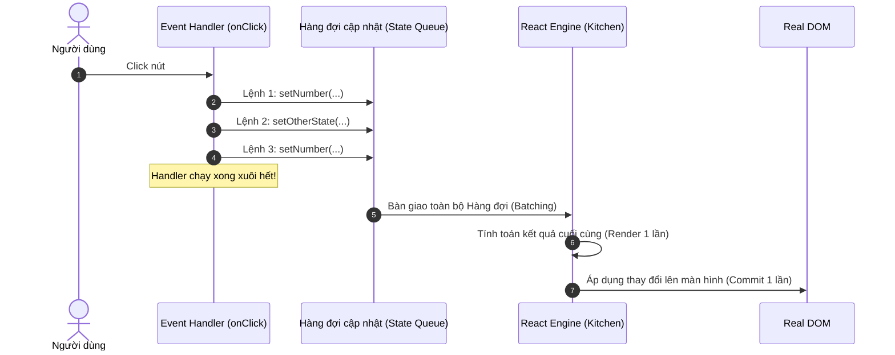

# **BÀI HỌC 14: QUEUEING A SERIES OF STATE UPDATES (HÀNG ĐỢI CẬP NHẬT STATE)**

> **Hành trình: Zero to Hero React**  
> **Chủ đề:** Cơ chế gom cụm (Automatic Batching); Hàm cập nhật (Updater Function); Giải thuật xử lý hàng đợi (State Queue Engine); Thoát hiểm với `flushSync`.  
> **Tài liệu tham khảo chính thức:** [React.dev - Queueing a Series of State Updates](https://react.dev/learn/queueing-a-series-of-state-updates)

---

## 🌟 TỔNG QUAN BÀI HỌC

Ở Bài 13, chúng ta đã hiểu tại sao gọi `setNumber(number + 1)` ba lần liên tiếp chỉ làm số tăng lên 1: vì cả 3 lệnh đều đọc cùng một bức ảnh Snapshot quá khứ. 

Nhưng đằng sau hiện tượng đó còn có một cơ chế kiến trúc tối thượng thứ hai của React: **Batching (Gom cụm cập nhật)**.

1. **React KHÔNG re-render ngay lập tức sau mỗi dòng lệnh `setState`**.
2. React sẽ kiên nhẫn chờ cho đến khi **toàn bộ mã nguồn trong Event Handler chạy xong xuôi**, gom tất cả các yêu cầu cập nhật lại thành một gói, rồi mới tiến hành Render một lần duy nhất.
3. Khi bạn thực sự cần cập nhật State nhiều lần liên tiếp dựa trên kết quả của bước trước, giải pháp chuẩn mực là dùng **Hàm cập nhật (Updater Function)**: `setNumber(n => n + 1)`.

---

## 1. ẨN DỤ NGƯỜI BỒI BÀN & CƠ CHẾ GOM CỤM (AUTOMATIC BATCHING)

### 1.1 Ẩn dụ Người Bồi Bàn (The Waiter Analogy)
Hãy tưởng tượng bạn đang đi ăn tại một nhà hàng sang trọng:
* Bạn nói với bồi bàn: *"Cho tôi 1 đĩa mì Ý"*.
* Người bồi bàn **không** lập tức cắm đầu chạy vào bếp giao món mì rồi mới chạy ra hỏi tiếp.
* Bồi bàn sẽ lịch sự đứng chờ bạn gọi nốt: *"Thêm 1 ly nước cam, à mà đổi mì Ý thành pizza hải sản nhé!"*.
* Chỉ sau khi bạn nói câu: *"Hết rồi em ơi!"*, bồi bàn mới mang toàn bộ phiếu gọi món đã chốt vào bếp một lần duy nhất.



### 1.2 Lợi ích của Batching
1. **Tối ưu hóa hiệu năng cực lớn:** Tránh việc trình duyệt phải tính toán lại Layout và vẽ lại màn hình (Browser Repaint) hàng chục lần vô ích.
2. **Ngăn chặn giao diện "nửa vời" (Inconsistent UI):** Giả sử bạn có 2 state `firstName` và `lastName`. Nếu không có batching, màn hình sẽ chớp giật hiển thị `firstName` mới nhưng `lastName` cũ trong vài mili-giây, tạo ra trải nghiệm người dùng rất tồi tệ.

### 1.3 React 18: Automatic Batching nâng cấp toàn diện
* **Trước React 18:** Batching chỉ hoạt động bên trong các React Event Handlers (như `onClick`, `onChange`). Nếu bạn gọi `setState` bên trong `setTimeout`, `Promise.then`, hay `fetch`, React sẽ re-render ngay sau mỗi dòng lệnh.
* **Từ React 18 trở đi:** Cơ chế **Automatic Batching** tự động gom cụm ở **MỌI NƠI** (kể cả trong `setTimeout`, `Promise`, `async/await`, và Native Event Listeners).

---

## 2. HÀM CẬP NHẬT (UPDATER FUNCTION): CẬP NHẬT STATE DỰA TRÊN KẾT QUẢ LIỀN TRƯỚC

Nếu bạn muốn cộng dồn State nhiều lần trước chu kỳ render tiếp theo, React cung cấp cú pháp truyền **Hàm cập nhật (Updater Function)**:

```jsx
import { useState } from 'react';

export default function Counter() {
  const [number, setNumber] = useState(0);

  return (
    <button onClick={() => {
      setNumber(n => n + 1);
      setNumber(n => n + 1);
      setNumber(n => n + 1);
    }}>+3</button>
  );
}
```

### 2.1 Cú pháp và Quy ước đặt tên
* `n => n + 1`: Là một pure function nhận vào **trạng thái đang chờ (Pending State)** và trả về **trạng thái tiếp theo (Next State)**.
* **Quy ước đặt tên (Naming Convention):** Thường dùng chữ cái đầu tiên của State hoặc tiền tố `prev`:
  * `setCount(c => c + 1)` hoặc `setCount(prevCount => prevCount + 1)`
  * `setEnabled(e => !e)`
  * `setLastName(ln => ln.trim())`

### 2.2 Giải phẫu cách React xử lý Hàng đợi (Queue Execution)

Khi hàm xử lý sự kiện kết thúc, React bắt đầu duyệt qua hàng đợi:

| Lệnh trong Hàng đợi | Tham số đầu vào `n` (Pending State) | Biểu thức tính toán | Kết quả trả về |
| :--- | :--- | :--- | :--- |
| `n => n + 1` | `0` (Giá trị State hiện tại) | `0 + 1` | **`1`** |
| `n => n + 1` | `1` (Kết quả dòng trước) | `1 + 1` | **`2`** |
| `n => n + 1` | `2` (Kết quả dòng trước) | `2 + 1` | **`3`** |

React lưu con số **`3`** làm kết quả cuối cùng và tiến hành Render. Kết quả màn hình hiển thị: **`3`**!

---

## 3. ĐIỀU GÌ XẢY RA KHI TRỘN LẪN "GIÁ TRỊ THAY THẾ" VÀ "HÀM CẬP NHẬT"?

Đây là câu hỏi phỏng vấn kinh điển bậc nhất về React internals. Hãy phân tích 2 kịch bản:

### 3.1 Kịch bản 1: Giá trị thay thế $\rightarrow$ Hàm cập nhật
```javascript
// Cho number ban đầu = 0
setNumber(number + 5);
setNumber(n => n + 1);
```
1. `setNumber(number + 5)`: Trong snapshot này `number = 0`, nên tương đương `setNumber(5)`. React đưa yêu cầu *"Thay thế bằng 5"* vào hàng đợi.
2. `setNumber(n => n + 1)`: React đưa hàm này vào hàng đợi. Khi xử lý, React lấy giá trị `5` đưa vào `n` $\rightarrow$ `5 + 1 = 6`.
* **Kết quả cuối cùng:** **`6`**.

### 3.2 Kịch bản 2: Hàm cập nhật $\rightarrow$ Giá trị thay thế (Hủy diệt công sức)
```javascript
// Cho number ban đầu = 0
setNumber(number + 5); // Xếp hàng: Thay thế bằng 5
setNumber(n => n + 1); // Xếp hàng: Lấy 5 + 1 = 6
setNumber(42);         // Xếp hàng: Đột ngột ghi đè thẳng bằng 42!
```
1. `setNumber(5)` $\rightarrow$ Hàng đợi có `5`.
2. `n => n + 1` $\rightarrow$ Hàng đợi tính ra `6`.
3. `setNumber(42)` $\rightarrow$ Bỏ qua toàn bộ kết quả `6` trước đó, ghi đè thẳng giá trị **`42`**.
* **Kết quả cuối cùng:** **`42`**.

> [!TIP]
> **Quy tắc vàng để ghi nhớ:**
> * Truyền **Hàm** (`n => ...`): React sẽ tiếp nối giá trị từ bước tính toán liền trước.
> * Truyền **Giá trị** (`42`): React xóa bỏ kết quả trước đó và ghi đè thẳng giá trị này.

---

## 4. TỰ TAY VIẾT LẠI LÕI XỬ LÝ HÀNG ĐỢI CỦA REACT (`getFinalState`)

Để thấu hiểu 100% cách React hoạt động nội bộ, hãy cùng tự tay triển khai thuật toán tính toán hàng đợi của React:

```javascript
/**
 * Mô phỏng State Queue Engine của React
 * @param {any} baseState - Giá trị State ban đầu
 * @param {Array<any | Function>} queue - Mảng chứa các giá trị và hàm cập nhật
 * @returns {any} Giá trị State cuối cùng
 */
export function getFinalState(baseState, queue) {
  let finalState = baseState;

  for (let update of queue) {
    if (typeof update === 'function') {
      // Nếu là Updater Function: Gọi hàm với Pending State hiện tại
      finalState = update(finalState);
    } else {
      // Nếu là Giá trị cố định: Gán đè trực tiếp
      finalState = update;
    }
  }

  return finalState;
}
```

---

## 5. CẠM BẪY THỰC TẾ: BẤT ĐỒNG BỘ & REQUEST COUNTER

Xét bài toán: Một ứng dụng thương mại điện tử có nút **"Mua hàng (Buy)"**.
* Khi bấm nút: Tăng số lượng `pending` lên 1.
* Sau 3 giây (mô phỏng xử lý thanh toán API): Giảm `pending` đi 1 và tăng `completed` lên 1.

### 5.1 Đoạn code bị lỗi nghiêm trọng
```javascript
// ❌ SAI LẦM: Dùng State Snapshot trực tiếp trong hàm bất đồng bộ
async function handleBuy() {
  setPending(pending + 1);
  await delay(3000);
  setPending(pending - 1); // BẪY NGUY HIỂM!
  setCompleted(completed + 1);
}
```
* **Hiện tượng lỗi:** Nếu người dùng bấm nút "Mua hàng" 3 lần liên tiếp nhanh tay:
  * Sau 3 giây, `pending` sẽ bị tụt xuống **số âm** (`-1` hoặc `-2`) thay vì trở về `0`!
  * **Nguyên nhân:** Cả 3 lần bấm đều bắt giữ `pending = 0` từ snapshot ban đầu, nên `0 - 1 = -1`.

### 5.2 Đoạn code chuẩn mực
```javascript
// ✅ CHUẨN MỰC: Luôn dùng Updater Function khi xử lý sau độ trễ bất đồng bộ
async function handleBuy() {
  setPending(p => p + 1);
  await delay(3000);
  setPending(p => p - 1); // Đảm bảo trừ dựa trên giá trị thực tế sau 3 giây!
  setCompleted(c => c + 1);
}
```

---

## 6. GÓC NHÌN SENIOR: ĐỐI CHIẾU VỚI BACKEND & CƠ SỞ DỮ LIỆU

Cơ chế Hàng đợi và Batching của React có sự tương đồng hoàn hảo với các thiết kế tối ưu hóa kinh điển trong Backend:

### 6.1 Hibernate JDBC Batching (`hibernate.jdbc.batch_size`)
* Trong các ứng dụng Spring Boot + Hibernate, nếu bạn lưu 1.000 thực thể vào DB trong một vòng lặp, việc gửi 1.000 câu lệnh `INSERT` riêng biệt sẽ gây tắc nghẽn I/O mạng nghiêm trọng.
* Thay vào đó, Hibernate bật tính năng **JDBC Batching**: Gom 50 hoặc 100 câu `INSERT` lại thành một lô duy nhất để gửi tới Database khi kết thúc Transaction (`session.flush()`).
* **Sự tương đồng:** React gom nhiều lệnh `setState` thành 1 batch khi kết thúc Event Handler; Hibernate gom nhiều câu SQL thành 1 batch khi kết thúc Transaction.

### 6.2 Message Queue (Kafka / RabbitMQ Pipeline)
* Các hàm cập nhật `n => n + 1` giống như các thông điệp (messages) được đẩy vào hàng đợi Kafka. Consumer (React Reconciler) sẽ tuần tự áp dụng từng phép biến đổi lên trạng thái dữ liệu (Event Sourcing).

---

## 7. CƠ CHẾ THOÁT HIỂM: `flushSync`

Trong một số trường hợp cực kỳ hiếm hoi (như khi bạn cần đo kích thước DOM ngay lập tức sau khi thay đổi State để cuộn trang), bạn có thể dùng `flushSync` từ `react-dom` để **ép React bỏ qua Batching và render ngay lập tức**:

```javascript
import { flushSync } from 'react-dom';

function handleClick() {
  flushSync(() => {
    setCount(count + 1);
  });
  // Ngay tại dòng này, Real DOM đã được cập nhật xong xuôi!
  console.log(domRef.current.offsetHeight);
}
```
> [!WARNING]
> `flushSync` gây suy giảm hiệu năng nặng nề vì phá vỡ cơ chế tối ưu Batching. Chỉ sử dụng khi thực sự bắt buộc và không còn giải pháp nào khác.

---

## 8. BỘ CÂU HỎI PHỎNG VẤN SENIOR REACT DEVELOPER

### Q1: Automatic Batching trong React 18 khác gì so với React 17?
* **Đáp án:** React 17 chỉ gom cụm (batch) các `setState` diễn ra bên trong React Event Handlers gốc. Nếu `setState` nằm trong `setTimeout`, `fetch`, hay `Promise`, React 17 sẽ re-render ngay sau mỗi lần gọi. React 18 kích hoạt Automatic Batching trên toàn bộ ứng dụng ở mọi ngữ cảnh bất đồng bộ.

### Q2: Khi nào thì BẮT BUỘC phải dùng Updater Function `setState(prev => ...)` thay vì giá trị cố định?
1. Khi cần cập nhật state nhiều lần liên tiếp trong cùng một chu kỳ sự kiện.
2. Khi cập nhật state sau một tác vụ bất đồng bộ (`setTimeout`, `fetch`, `async/await`) để tránh lỗi đọc stale state từ closure cũ.
3. Khi hàm logic tách rời không muốn phụ thuộc trực tiếp vào biến state trong scope (giúp giảm bớt dependency trong `useEffect` hoặc `useCallback`).

### Q3: Hàm Updater Function có bắt buộc phải là Pure Function không? Vì sao?
* **Đáp án:** **Bắt buộc 100% phải là Pure Function**. Trong chế độ React Strict Mode (khi chạy ở môi trường phát triển), React sẽ chủ động **gọi hàm Updater Function 2 lần liên tiếp** với cùng một tham số để phát hiện các side-effects hoặc hành vi đột biến dữ liệu ngoài ý muốn.