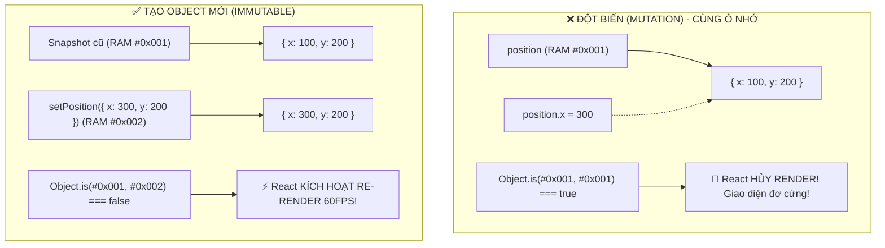

# **BÀI HỌC 15: UPDATING OBJECTS IN STATE (CẬP NHẬT OBJECT TRONG STATE)**

> **Hành trình: Zero to Hero React**  
> **Chủ đề:** Bản chất Đột biến (Mutation) vs Bất biến (Immutability); Cơ chế so sánh tham chiếu (`Object.is`); Cú pháp Spread `...`; Xử lý Nested Object và Thư viện Immer (`use-immer`).  
> **Tài liệu tham khảo chính thức:** [React.dev - Updating Objects in State](https://react.dev/learn/updating-objects-in-state)

---

## 🌟 TỔNG QUAN BÀI HỌC

Trong JavaScript, các kiểu dữ liệu nguyên thủy (*Primitives*: số `42`, chuỗi `'Tùng'`, boolean `true`, `null`, `undefined`) đều là **bất biến (Immutable)**. Bạn không thể "sửa" bản thân con số `42`. Khi bạn gọi `setCount(43)`, bạn đang hoàn toàn **thay thế** số `42` bằng số `43`.

Tuy nhiên, **Object** (và Array) là các kiểu dữ liệu **tham chiếu (Reference Types)** có thể bị thay đổi nội dung bên trong:
```javascript
const user = { name: 'Alice' };
user.name = 'Bob'; // Hoàn toàn hợp lệ trong JavaScript thuần!
```

Hành động thay đổi trực tiếp nội dung bên trong một Object được gọi là **Đột biến (Mutation)**.  
Và đây là **cạm bẫy số 1** khiến vô số người mới học React gặp lỗi giao diện không chịu cập nhật!

---

## 1. TẠI SAO ĐỘT BIẾN (MUTATION) LÀ KẺ THÙ SỐ 1 CỦA REACT?

Hãy xem xét đoạn mã nguồn di chuyển con trỏ chuột theo tọa độ:

```jsx
const [position, setPosition] = useState({ x: 0, y: 0 });

return (
  <div onPointerMove={e => {
    // ❌ SAI LẦM CHÍ MẠNG: Đột biến trực tiếp State hiện tại
    position.x = e.clientX;
    position.y = e.clientY;
  }}>
    <div style={{ transform: `translate(${position.x}px, ${position.y}px)` }} />
  </div>
);
```

### 1.1 Hai lý do cốt tử khiến đoạn code trên "chết đứng"
1. **Bạn không gọi hàm Setter (`setPosition`)**: React chỉ re-render khi bạn bấm chuông thông báo qua hàm Setter. Khi bạn gán `position.x = ...`, bạn đang âm thầm sửa dữ liệu sau lưng React. React hoàn toàn không hay biết để vẽ lại màn hình.
2. **React so sánh tham chiếu bộ nhớ (`Object.is`)**: Giả sử sau đó bạn có gọi `setPosition(position)`, React sẽ kiểm tra:
   $$\text{Object.is}(prevPosition, nextPosition)$$
   Vì cả hai biến đều trỏ chung vào **cùng một địa chỉ ô nhớ RAM** (`#0x001`), React kết luận: *"Ủa, object này có khác gì object cũ đâu!"* và lập tức **hủy bỏ chu trình Render (Bail out)**!



> [!IMPORTANT]
> **ĐỊNH LUẬT TỐI THƯỢNG:**  
> Dù Object trong JavaScript có thể đột biến, nhưng một khi đã đưa vào React State, bạn phải **LUÔN COI CHÚNG LÀ DỮ LIỆU CHỈ ĐỌC (READ-ONLY)**. Tuyệt đối không bao giờ dùng toán tử gán `=` lên thuộc tính của State!

---

## 2. CÁCH CẬP NHẬT CHUẨN: TẠO OBJECT MỚI HOÀN TOÀN

Cách duy nhất đúng là tạo ra một Object mới toanh với địa chỉ RAM mới và gửi nó vào hàm Setter:

```jsx
// ✅ CHUẨN MỰC: Tạo Object mới
onPointerMove={e => {
  setPosition({
    x: e.clientX,
    y: e.clientY
  });
}}
```

React nhận thấy `#0x002 !== #0x001`, lập tức tiến hành chu trình Re-render và di chuyển con trỏ mượt mà trên màn hình.

---

## 3. SAO CHÉP THUỘC TÍNH VỚI TOÁN TỬ SPREAD (`...`)

Trong các Form có nhiều trường dữ liệu, bạn thường chỉ muốn cập nhật 1 trường duy nhất (ví dụ đổi `firstName`) và giữ nguyên các trường khác (`lastName`, `email`).

### 3.1 Cú pháp Spread Object
```javascript
const [person, setPerson] = useState({
  firstName: 'Lê',
  lastName: 'Tùng',
  email: 'tung@example.com'
});

// Cập nhật firstName, giữ nguyên toàn bộ các trường khác:
setPerson({
  ...person,                // 1. Trải toàn bộ các thuộc tính cũ ra
  firstName: e.target.value // 2. Ghi đè đúng thuộc tính firstName
});
```

> [!WARNING]
> **Thứ tự khai báo cực kỳ quan trọng!**
> * `{ ...person, firstName: 'Tùng' }`: `firstName` mới sẽ **ghi đè** giá trị cũ (Đúng).
> * `{ firstName: 'Tùng', ...person }`: `person` cũ sẽ **ghi đè ngược lại** làm mất giá trị mới (Sai)!

### 3.2 Tối ưu hóa: Dùng chung 1 hàm duy nhất cho toàn bộ Form
Bằng cách gán thuộc tính `name` cho thẻ `<input>` trùng với tên trường trong State, bạn có thể dùng cú pháp **Computed Property Names (`[e.target.name]`)** để xử lý hàng chục ô input chỉ với 1 hàm:

```jsx
function handleChange(e) {
  setPerson({
    ...person,
    [e.target.name]: e.target.value // Tự động khớp với name="firstName", name="email"...
  });
}

return (
  <>
    <input name="firstName" value={person.firstName} onChange={handleChange} />
    <input name="lastName" value={person.lastName} onChange={handleChange} />
    <input name="email" value={person.email} onChange={handleChange} />
  </>
);
```

---

## 4. VẤN ĐỀ CỦA NESTED OBJECT (OBJECT LỒNG NHAU) & COPY NÔNG

Toán tử `...` của JavaScript là **Copy Nông (Shallow Copy)**: nó chỉ nhân bản các trường ở tầng ngoài cùng cấp 1. Các Object lồng sâu bên trong vẫn giữ nguyên con trỏ tham chiếu cũ!

```javascript
const [person, setPerson] = useState({
  name: 'Lê Tùng',
  artwork: {
    title: 'Bình minh trên biển',
    city: 'Đà Nẵng'
  }
});
```

### 4.1 Cập nhật Nested Object bằng cú pháp Spread thủ công
Để sửa `city`, bạn phải rải `...` từ ngoài vào trong:

```javascript
setPerson({
  ...person, // Copy tầng 1
  artwork: {
    ...person.artwork, // Copy tầng 2
    city: 'Hà Nội'     // Ghi đè thuộc tính tầng 2
  }
});
```
* **Nhược điểm:** Nếu Object lồng sâu 4-5 tầng, code sẽ trở nên cực kỳ cồng kềnh, rối mắt và rất dễ viết sót thuộc tính gây mất dữ liệu.

---

## 5. THƯ VIỆN IMMER: VIẾT CODE ĐỘT BIẾN NHƯNG HOẠT ĐỘNG BẤT BIẾN

Để giải phóng lập trình viên khỏi "cơn ác mộng" rải dấu `...` nhiều tầng, cộng đồng React sử dụng thư viện **Immer** (thông qua hook `use-immer`).

### 5.1 Immer hoạt động như thế nào? (Cơ chế Proxy)
1. Immer cung cấp cho bạn một đối tượng đặc biệt gọi là **`draft`** (Bản nháp), được bọc bởi JavaScript `Proxy`.
2. Bạn được phép viết code sửa trực tiếp: `draft.artwork.city = 'Hà Nội'`.
3. Proxy ghi lại tất cả các thao tác sửa đổi này.
4. Cuối cùng, Immer tự động tạo ra một bản sao bất biến mới hoàn toàn (áp dụng kỹ thuật **Structural Sharing** - tái sử dụng những nhánh không bị sửa để tiết kiệm RAM).

```jsx
import { useImmer } from 'use-immer';

const [person, updatePerson] = useImmer({
  name: 'Lê Tùng',
  artwork: {
    title: 'Bình minh trên biển',
    city: 'Đà Nẵng'
  }
});

function handleCityChange(e) {
  // ✅ Cực kỳ ngắn gọn, trực quan và an toàn 100%!
  updatePerson(draft => {
    draft.artwork.city = e.target.value;
  });
}
```

---

## 6. GÓC NHÌN SENIOR: ĐỐI CHIẾU VỚI BACKEND & CƠ SỞ DỮ LIỆU

### 6.1 So sánh với Java Lombok `@Builder(toBuilder = true)`
Trong kiến trúc Domain-Driven Design (DDD) của Java / Spring Boot, các `Value Object` cũng được thiết kế bất biến (Immutable). Để tạo bản sao với một trường thay đổi, lập trình viên Java dùng phương thức `toBuilder()`:

```java
// Java Spring Boot Record / Lombok Immutable Object
Account updatedAccount = account.toBuilder()
    .balance(newBalance) // Tương đương { ...account, balance: newBalance }
    .build();
```

### 6.2 So sánh với Hibernate Managed Entity vs Detached Entity
* Trong Hibernate, các entity trong Persistence Context (`EntityManager`) là **Mutable**. Hibernate dùng cơ chế *Snapshot Dirty Checking* để tự động phát hiện trường nào bị `setter` sửa đổi.
* Ngược lại, React chọn triết lý **Pure Functional Immutability**: Không dirty-check từng trường bên trong object, mà chỉ kiểm tra địa chỉ tham chiếu ngoài cùng `Object.is(oldRef, newRef)` với độ phức tạp $O(1)$ siêu tốc.

---

## 7. BÀI TẬP THỬ THÁCH (CHALLENGES) TỪ REACT DOCS

### 7.1 Thử thách 1: Form điểm cầu thủ không cập nhật (Fix score update)
* **Lỗi:** Code cũ dùng `player.score++` (Đột biến trực tiếp, không re-render) và `setPlayer({ lastName: ... })` (Quên `...player` làm mất `firstName` và `score`).
* **Sửa chuẩn:**
  ```javascript
  setPlayer({ ...player, score: player.score + 1 });
  setPlayer({ ...player, lastName: e.target.value });
  ```

### 7.2 Thử thách 2: Background tự nhiên bị nhảy vị trí (Shared Reference Mutation Bug)
* **Lỗi ẩn cực hiểm:** Khai báo một object tọa độ mặc định ở phạm vi toàn cục:
  ```javascript
  const initialPosition = { x: 0, y: 0 }; // Biến Global dùng chung!
  ```
  Khi người dùng kéo thả hình khối, code bên trong lại viết:
  `shape.position.x += dx;` $\rightarrow$ Vô tình làm đột biến luôn biến toàn cục `initialPosition`!
  Khi màn hình đổi màu, Background đọc lại `initialPosition` và bị nhảy vị trí theo.
* **Cách khắc phục:** Không đột biến biến dùng chung, luôn dùng Spread tạo object mới.

---

## 8. BỘ CÂU HỎI PHỎNG VẤN SENIOR REACT DEVELOPER

### Q1: Tại sao React lại chọn cơ chế Immutability (Bất biến) thay vì Mutation như Vue hay Svelte?
* **Đáp án:**
  1. **Hiệu năng $O(1)$:** So sánh tham chiếu `Object.is(a, b)` chỉ mất 1 phép tính CPU, không cần duyệt đệ quy sâu vào từng thuộc tính của cây dữ liệu lớn.
  2. **Dễ dàng làm Time-Travel Debugging & Undo/Redo:** Mỗi trạng thái trong quá khứ là một snapshot bất biến nguyên vẹn, không bị các thao tác sau làm biến dạng.
  3. **Khả năng tối ưu với `React.memo` & PureComponent:** Dễ dàng quyết định xem component con có cần re-render hay không chỉ bằng phép so sánh nông `prevProps === nextProps`.

### Q2: Khái niệm "Structural Sharing" trong Immer là gì?
* **Đáp án:** Structural Sharing là kỹ thuật tối ưu bộ nhớ: Khi bạn sửa đổi một thuộc tính nằm sâu trong một cây Object, Immer chỉ tạo bản sao mới cho các nút nằm trên con đường dẫn tới thuộc tính đó. Tất cả các nhánh anh em khác không bị sửa đổi sẽ được giữ nguyên tham chiếu cũ, giúp tiết kiệm RAM và giảm thiểu tối đa re-render không cần thiết.