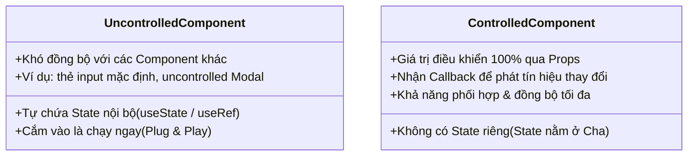

# **CHƯƠNG 3: MANAGING STATE (QUẢN LÝ TRẠNG THÁI)**
# **BÀI HỌC 19: SHARING STATE BETWEEN COMPONENTS (CHIA SẺ STATE GIỮA CÁC COMPONENT)**

> **Hành trình: Zero to Hero React**  
> **Chủ đề:** Kỹ thuật Kéo State lên Cha (Lifting State Up); Luồng dữ liệu một chiều (Unidirectional Data Flow); Phân định Controlled vs Uncontrolled Components; Triết lý Nguồn Sự Thật Duy Nhất (Single Source of Truth); Giải quyết Prop Drilling với Component Composition.  
> **Tài liệu tham khảo chính thức:** [React.dev - Sharing State Between Components](https://react.dev/learn/sharing-state-between-components)

---

## 🌟 TỔNG QUAN BÀI HỌC

Trong React, dữ liệu tuân theo nguyên lý **Luồng dữ liệu một chiều (Top-Down / Unidirectional Data Flow)**. Hai component "anh em" (Siblings) nằm ngang hàng nhau trong cây DOM **hoàn toàn không thể tự ý bắn dữ liệu trực tiếp sang cho nhau**.

Khi bạn cần trạng thái của hai hay nhiều component luôn luôn đồng bộ và phản hồi qua lại:
1. Bạn không thể "lén lút" gán biến toàn cục hay gọi DOM trực tiếp.
2. Bạn không thể để mỗi con tự giữ một bản sao State riêng (sẽ dẫn đến lệch pha dữ liệu).
3. 💡 **Giải pháp chuẩn mực duy nhất:** **Kéo State lên Cha chung gần nhất (Lifting State Up)**, biến các component con thành **Controlled Components**, và biến component Cha thành **Nguồn Sự Thật Duy Nhất (Single Source of Truth)**.

---

## 1. BẢN CHẤT: TẠI SAO PHẢI "KÉO STATE LÊN CHA"?

```mermaid
graph TD
    subgraph SAI: Hai anh em cố tự giao tiếp
        A1[Component Cha]
        S1[Component Con A<br/>State: count=1] -.->|❌ KHÔNG THỂ gọi trực tiếp| S2[Component Con B<br/>State: count=0]
        A1 --> S1
        A1 --> S2
    end

    subgraph ĐÚNG: Kéo State lên Cha (Lifting State Up)
        P[Component Cha Chung<br/>🔑 State: activeIndex = 0]
        C1[Component Con A<br/>Nhận Prop: isActive=true]
        C2[Component Con B<br/>Nhận Prop: isActive=false]
        
        P -->|Props: isActive=true, onShow| C1
        P -->|Props: isActive=false, onShow| C2
        C2 -.->|Event Callback: onShow| P
    end
```

### Triết lý Luồng Dữ Liệu Một Chiều:
* **Props đi xuống (Data flows DOWN):** Cha truyền giá trị trạng thái và cờ hiển thị xuống cho các con.
* **Events đi lên (Events flow UP):** Khi người dùng tương tác ở con, con gọi hàm Callback do Cha truyền xuống để "báo cáo" lên Cha. Cha cập nhật State, kích hoạt re-render toàn bộ cây nhánh đó.

---

## 2. QUY TRÌNH 3 BƯỚC CHUẨN MỰC "LIFTING STATE UP"

Xét bài toán kinh điển: **Thanh Accordion (Hộp thu gọn/mở rộng)** gồm nhiều `Panel`. Yêu cầu: **Chỉ cho phép mở tối đa 1 Panel tại một thời điểm**. Khi mở Panel B thì Panel A đang mở phải tự động đóng lại.

### Bước 1: Xóa State ở các Component Con
Tước quyền tự quyết định của component con. Chuyển đổi biến State nội bộ thành Props nhận từ bên ngoài.

```jsx
// ❌ TRƯỚC ĐÂY: Con tự quyết định đóng/mở (Uncontrolled)
function Panel({ title, children }) {
  const [isActive, setIsActive] = useState(false); // Con tự giữ state!
  return (
    <div className="panel">
      <h3>{title}</h3>
      {isActive ? <p>{children}</p> : <button onClick={() => setIsActive(true)}>Mở</button>}
    </div>
  );
}

// ✅ BÂY GIỜ: Tước quyền tự trị, biến thành Controlled Component
function Panel({ title, children, isActive, onShow }) {
  // Không còn useState nữa!
  return (
    <div className="panel">
      <h3>{title}</h3>
      {isActive ? (
        <p>{children}</p>
      ) : (
        <button onClick={onShow}>Mở</button>
      )}
    </div>
  );
}
```

### Bước 2: Tìm Component Cha chung gần nhất (Closest Common Ancestor)
Quan sát cây Component để xác định nơi hội tụ gần nhất của các con cần chia sẻ dữ liệu:
* `<Accordion>` **(ĐÂY LÀ CHA CHUNG GẦN NHẤT)**
  * `<Panel index={0} />`
  * `<Panel index={1} />`

### Bước 3: Đặt State ở Cha và điều phối dữ liệu qua Props
Component Cha `<Accordion>` nắm giữ State `activeIndex` (biết bảng nào đang mở), tính toán giá trị boolean `isActive` và truyền kèm hàm callback `onShow` xuống từng con:

```jsx
export default function Accordion() {
  // Cha nắm giữ chiếc chìa khóa duy nhất:
  const [activeIndex, setActiveIndex] = useState(0);

  return (
    <div className="accordion">
      <h2>Danh mục câu hỏi thường gặp</h2>
      
      <Panel
        title="1. React là gì?"
        isActive={activeIndex === 0}
        onShow={() => setActiveIndex(0)}
      >
        React là một thư viện JavaScript declarative, hiệu quả và linh hoạt để xây dựng UI.
      </Panel>

      <Panel
        title="2. Lifting State Up là gì?"
        isActive={activeIndex === 1}
        onShow={() => setActiveIndex(1)}
      >
        Là kỹ thuật di chuyển State lên Component Cha chung gần nhất để chia sẻ giữa các con.
      </Panel>
    </div>
  );
}
```

---

## 3. THUẬT NGỮ CỐT LÕI: CONTROLLED VS UNCONTROLLED COMPONENTS

Khái niệm này xuất hiện liên tục trong tài liệu React và các buổi phỏng vấn tuyển dụng:



### Bảng so sánh chi tiết:

| Tiêu chí so sánh | Uncontrolled Component (Tự trị) | Controlled Component (Bị điều khiển) |
| :--- | :--- | :--- |
| **Nơi lưu trữ State** | Nằm bên trong ruột của chính component đó | Nằm ở Component Cha hoặc State Manager |
| **Cách truyền dữ liệu** | Dùng `defaultValue` hoặc truy xuất qua `useRef` | Nhận `value` / `isActive` trực tiếp qua Props |
| **Khả năng đồng bộ** | Kém; cha không thể ép con đổi trạng thái theo ý muốn | Hoàn hảo; cha toàn quyền quyết định khi nào mở/đóng/đổi |
| **Mức độ phụ thuộc** | Độc lập, dễ tái sử dụng như một widget độc lập | Phụ thuộc vào Cha truyền Props và Event Handler |
| **Tình huống sử dụng** | Form đơn giản, input tìm kiếm độc lập, quick prototyping | Form xác thực phức tạp, Accordion 1-tab, bộ lọc đa cấp |

> [!TIP]
> **Component linh hoạt (Hybrid Component):**  
> Trong các thư viện UI lớn (như Radix UI, Ant Design, Material UI), các component thường hỗ trợ cả hai chế độ: Nếu Cha truyền prop `value` thì chạy theo kiểu **Controlled**, nếu không truyền thì tự dùng state ngầm làm **Uncontrolled**.

---

## 4. TRIẾT LÝ "NGUỒN SỰ THẬT DUY NHẤT" (SINGLE SOURCE OF TRUTH)

Khi phát triển ứng dụng React, lỗi phổ biến nhất ở Junior Developer là tạo ra nhiều bản sao State giống hệt nhau:
* Con A có một State `text`.
* Con B có một State `duplicateText`.
* Sau đó dùng `useEffect` để cố gắng đồng bộ 2 biến này. Kết quả: Vòng lặp re-render vô tận hoặc dữ liệu bị chập chờn.

### Quy tắc bất biến:
> [!CRITICAL]
> Với mỗi phần thông tin động trong giao diện người dùng, **CHỈ CÓ MỘT COMPONENT DUY NHẤT ĐƯỢC PHÉP SỞ HỮU STATE ĐÓ**.  
> Tất cả các component khác cần sử dụng thông tin này phải nhận nó dưới dạng **Props** hoặc giá trị **Derived State**.

### Ví dụ Thực Tế: Bộ chuyển đổi nhiệt độ (Celsius <-> Fahrenheit)
Thay vì lưu cả 2 state `celsius` và `fahrenheit` (rất dễ mâu thuẫn):
* Chỉ lưu 1 giá trị duy nhất: `temperature` và `scale` ('c' hoặc 'f').
* Hoặc đơn giản hơn: Luôn quy đổi mọi thứ về độ C lưu trong State của Cha, độ F được tính toán phái sinh (`Derived`) ngay trong lúc render!

---

## 5. CẠM BẪY PROP DRILLING VÀ GIẢI PHÁP COMPONENT COMPOSITION

Khi kéo State lên Cha, nếu cây component có độ sâu 4-5 tầng:
```text
Page (Chứa state user)
  └── Dashboard
        └── Sidebar
              └── UserProfile
                    └── Avatar (Cần dùng user.avatar)
```
Việc phải chuyền prop `user` qua `Dashboard`, `Sidebar`, `UserProfile` chỉ để đến được `Avatar` gọi là **Prop Drilling** (Khoan Props qua các tầng trung gian).

### 2 Cách hóa giải Prop Drilling:
1. **Component Composition (Truyền JSX qua `children`):**  
   Thay vì truyền dữ liệu xuống sâu, hãy đưa component con lên cao và lồng ghép bằng slot `children`:
   ```jsx
   <Page>
     <Dashboard
       sidebar={<Sidebar profile={<UserProfile avatar={<Avatar src={user.avatar} />} />} />}
     />
   </Page>
   ```
2. **React Context (`useContext`):** Sẽ được học chuyên sâu ở Bài 22 để phát sóng dữ liệu cho toàn bộ cây mà không cần chuyền prop trung gian.

---

## 6. LỜI GIẢI CHI TIẾT CÁC BÀI TẬP THỬ THÁCH (REACT.DEV CHALLENGES)

### Thử thách 1: Đồng bộ hóa 2 ô nhập liệu (Synced Inputs)
* **Yêu cầu:** Có hai ô input độc lập. Khi người dùng gõ vào bất kỳ ô nào, ô còn lại phải lập tức hiển thị nội dung y hệt.
* **Nguyên nhân lỗi ban đầu:** Mỗi component `<Input />` tự chứa `const [text, setText] = useState('')`. Chúng không biết gì về nhau.
* **Lời giải chuẩn:**
  1. Xóa `useState` trong `<Input />`.
  2. Đặt `const [text, setText] = useState('')` ở component Cha `<SyncedInputs />`.
  3. Truyền `value={text}` và `onChange={e => setText(e.target.value)}` xuống cả 2 con.

```jsx
function Input({ label, value, onChange }) {
  return (
    <label>
      {label}: <input value={value} onChange={onChange} />
    </label>
  );
}

export default function SyncedInputs() {
  const [text, setText] = useState('');
  function handleChange(e) {
    setText(e.target.value);
  }
  return (
    <>
      <Input label="Ô thứ nhất" value={text} onChange={handleChange} />
      <Input label="Ô thứ hai" value={text} onChange={handleChange} />
    </>
  );
}
```

### Thử thách 2: Lọc danh sách theo thanh tìm kiếm (Filtering a list)
* **Yêu cầu:** Gõ từ khóa vào `<SearchBar />` thì danh sách `<List />` bên dưới phải tự động lọc kết quả.
* **Lời giải chuẩn:**
  1. `<SearchBar />` và `<List />` là hai anh em.
  2. Kéo biến `query` lên Cha `<FilterableList />`.
  3. Cha tính toán mảng kết quả đã lọc: `const results = filterItems(foods, query);`.
  4. Cha truyền `results` xuống cho `<List items={results} />` và truyền `query` + `setQuery` xuống cho `<SearchBar />`.

---

## 7. BỘ CÂU HỎI PHỎNG VẤN SENIOR REACT DEVELOPER

### Q1: Khi nào thì bạn nên chọn Controlled Component, và khi nào nên dùng Uncontrolled Component?
* **Đáp án:**
  - **Dùng Controlled:** Khi bạn cần kiểm soát dữ liệu tức thời trong lúc người dùng thao tác (Real-time Validation, Format số điện thoại tự động khi gõ, Disable nút Submit dựa trên dữ liệu nhập, Đồng bộ dữ liệu giữa nhiều ô input).
  - **Dùng Uncontrolled:** Khi bạn có form đơn giản chỉ cần lấy dữ liệu một lần duy nhất lúc bấm nút Submit (đọc dữ liệu qua `FormData(e.target)` hoặc `ref`), giúp tối ưu hiệu năng không phải re-render component mỗi khi người dùng gõ 1 ký tự.

### Q2: Việc kéo State lên Component Cha quá cao có gây ảnh hưởng gì đến hiệu năng (Performance) không? Cách khắc phục?
* **Đáp án:**
  - **Ảnh hưởng:** Khi State được đặt ở Cha cấp cao, mỗi lần State thay đổi, component Cha và **TOÀN BỘ CÂY CON BÊN DƯỚI NÓ** sẽ mặc định bị kích hoạt chạy lại hàm Render. Nếu cây con chứa danh sách hàng nghìn phần tử hoặc biểu đồ nặng, giao diện sẽ bị lag/khựng giật.
  - **Khắc phục:**
    1. Chỉ kéo State lên **Cha chung gần nhất (Closest Common Ancestor)**, không kéo lên tận Root App nếu không cần thiết.
    2. Tách nhỏ Component để gom cụm phạm vi Re-render.
    3. Sử dụng `React.memo` cho các component con tĩnh để bỏ qua việc re-render khi props không đổi.
    4. Sử dụng kỹ thuật Component Composition (`children` prop) để con không bị tính vào phạm vi render của cha.

### Q3: Phân biệt "Lifting State Up" và "Global State Management" (như Redux, Zustand, Context)?
* **Đáp án:**
  - **Lifting State Up:** Giải pháp cục bộ (Local / Feature-level). Phù hợp khi chia sẻ dữ liệu giữa các component nằm gần nhau trong cùng một cụm tính năng (như Accordion, Form + Preview). Không cần cài thư viện ngoài.
  - **Global State Management:** Giải pháp toàn cục (Application-level). Phù hợp cho dữ liệu xuyên suốt toàn ứng dụng như Thông tin đăng nhập người dùng (Auth Session), Cài đặt giao diện (Theme Sáng/Tối), Giỏ hàng thương mại điện tử (Shopping Cart). Giúp tránh hoàn toàn tình trạng Prop Drilling qua hàng chục tầng.