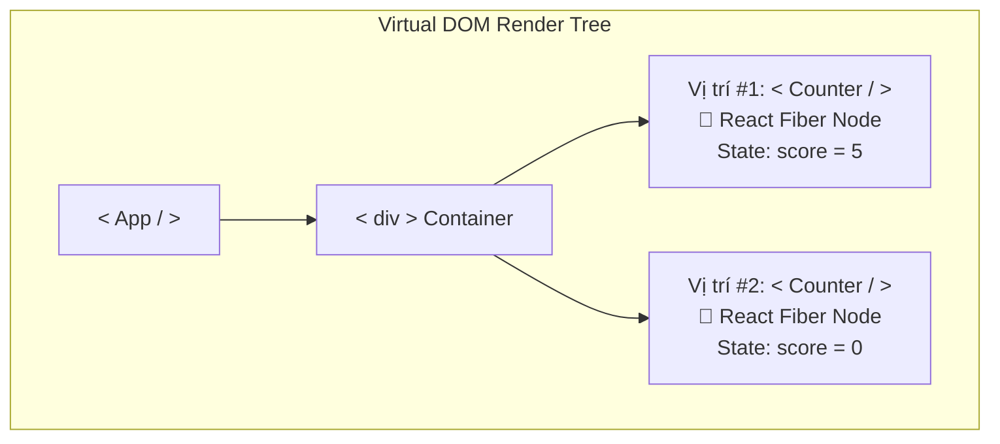
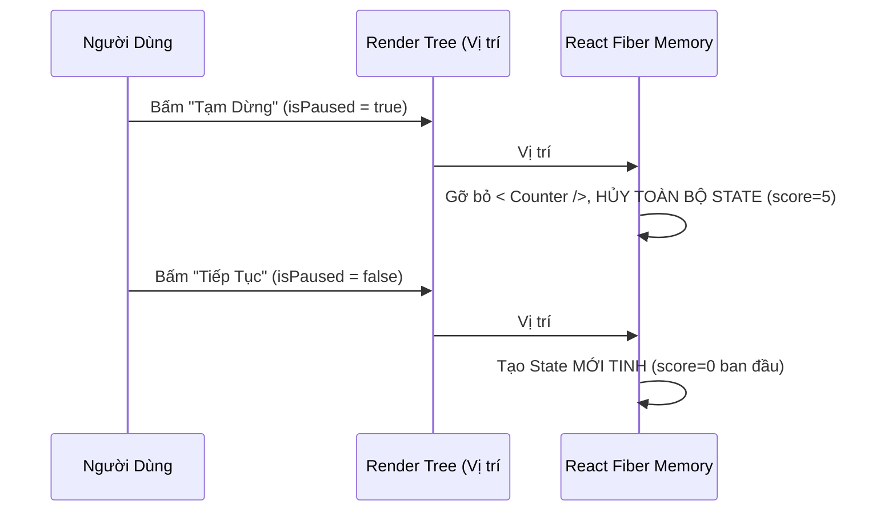
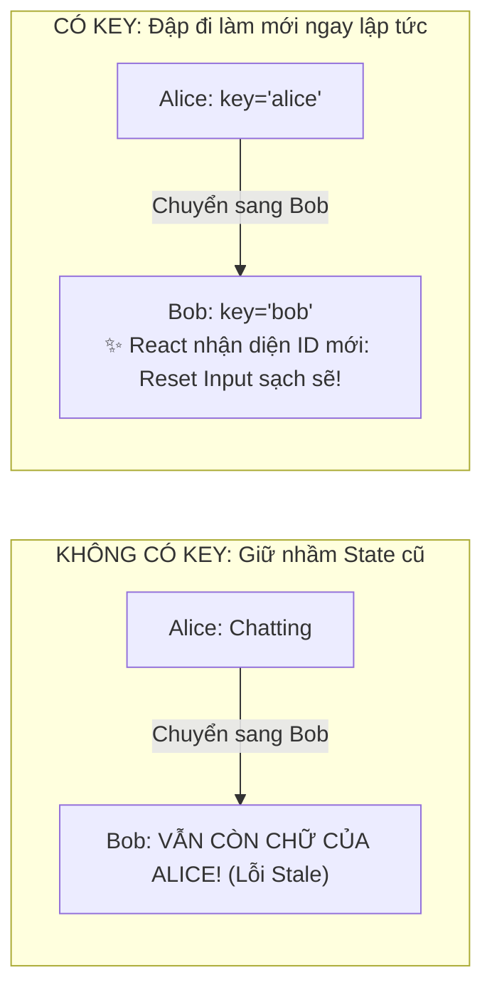

# **CHƯƠNG 3: MANAGING STATE (QUẢN LÝ TRẠNG THÁI)**
# **BÀI HỌC 20: PRESERVING AND RESETTING STATE (BẢO TOÀN VÀ LÀM MỚI STATE)**

> **Hành trình: Zero to Hero React**  
> **Chủ đề:** Bản chất lưu trữ State trong Cây Render; 2 Quy tắc vàng bảo toàn và làm mới State; Chiến thuật dùng `key` làm mới State có chủ đích; Thảm họa khai báo Component lồng nhau (Nested Component Trap); Giải quyết triệt để 5 thử thách hóc búa của React.dev.  
> **Tài liệu tham khảo chính thức:** [React.dev - Preserving and Resetting State](https://react.dev/learn/preserving-and-resetting-state)

---

## 🌟 TỔNG QUAN BÀI HỌC

Một trong những câu hỏi gây hoang mang nhất cho lập trình viên mới học React:
* *"Tại sao tôi đổi giao diện mà điểm số trong Counter vẫn không bị mất?"*
* *"Tại sao tôi bấm chuyển từ tin nhắn của Alice sang Bob mà chữ tôi vừa gõ lại vẫn nằm nguyên trong ô input của Bob?"*
* *"Tại sao khi tôi gõ được một chữ vào ô input thì con trỏ chuột bị văng ra ngoài (mất focus)?"*

Tất cả những hiện tượng "bí ẩn" trên đều xoay quanh một quy luật cốt lõi duy nhất:  
> [!CRITICAL]
> **State KHÔNG HỀ NẰM BÊN TRONG HÀM COMPONENT!**  
> State được React quản lý độc lập trong cấu trúc cây bộ nhớ (Render Tree / Fiber Node).  
> **VỊ TRÍ CỦA COMPONENT TRONG CÂY GIAO DIỆN QUYẾT ĐỊNH TUỔI THỌ VÀ DANH TÍNH CỦA STATE.**

---

## 1. BẢN CHẤT: STATE SỐNG Ở ĐÂU VÀ KHI NÀO BỊ TIÊU HỦY?



1. **Bộ nhớ độc lập:** Khi bạn render hai component `<Counter />` cạnh nhau, React tạo ra 2 "két sắt" bộ nhớ riêng biệt gắn vào 2 tọa độ (Vị trí #1 và Vị trí #2) trong Render Tree. Thao tác tăng điểm ở #1 không bao giờ làm ảnh hưởng tới #2.
2. **Quy tắc sống còn:** Chừng nào component còn được giữ tại vị trí đó trong cây, React sẽ **bảo toàn State** của nó. Nếu component bị gỡ khỏi cây (Unmount), React lập tức **tiêu hủy hoàn toàn** State đó.

---

## 2. HAI QUY TẮC VÀNG QUYẾT ĐỊNH SỰ TỒN TẠI CỦA STATE

### Quy Tắc 1: Cùng Component + Cùng Vị Trí = BẢO TOÀN STATE

Xét đoạn mã đổi kiểu dáng giao diện bằng toán tử ba ngôi `? :`:

```jsx
export default function App() {
  const [isFancy, setIsFancy] = useState(false);

  return (
    <div>
      {isFancy ? (
        <Counter isFancy={true} /> // Dòng A
      ) : (
        <Counter isFancy={false} /> // Dòng B
      )}
      <button onClick={() => setIsFancy(!isFancy)}>Đổi Kiểu</button>
    </div>
  );
}
```

#### Ảo giác thị giác vs Sự thật của React:
* **Mắt người nhìn:** Thấy 2 dòng code `<Counter />` khác nhau ở 2 nhánh lệnh, tưởng rằng React sẽ đập cái này đi để tạo cái kia.
* **React Reconciliation:** React không quan tâm bạn viết bao nhiêu nhánh `if/else`. Tại vị trí **đứa con đầu tiên** của thẻ `<div>`, bản render cũ là `<Counter />`, bản render mới **vẫn là** `<Counter />`.
* 💡 **Kết luận:** Cùng vị trí #1, cùng loại component `<Counter />` ➡️ **React giữ nguyên State điểm số hiện tại** và chỉ thay đổi prop `isFancy`!

---

### Quy Tắc 2: Khác Component + Cùng Vị Trí = XÓA SẠCH VÀ LÀM MỚI STATE

Nếu bạn tráo đổi một thẻ HTML hoặc một loại Component khác vào cùng một vị trí:

```jsx
export default function App() {
  const [isPaused, setIsPaused] = useState(false);

  return (
    <div>
      {isPaused ? (
        <p>Tạm dừng trò chơi!</p> // Thẻ p thế chỗ
      ) : (
        <Counter /> // Component Counter bị gỡ bỏ
      )}
      <button onClick={() => setIsPaused(!isPaused)}>Tạm dừng</button>
    </div>
  );
}
```



> [!WARNING]
> Khi một component bị thay thế bằng một loại component khác tại cùng vị trí, React **nhổ bật gốc** toàn bộ cây con bên dưới nó và tiêu hủy mọi State liên quan!

---

## 3. CẠM BẪY TỬ HUYỆT: KHAI BÁO COMPONENT LỒNG NHAU (NESTED COMPONENT)

Đây là lỗi phổ biến nhất khiến các lập trình viên mới mất hàng giờ đồng hồ gãi đầu:
```jsx
// ❌ CẠM BẪY TỬ HUYỆT: Khai báo hàm con bên trong hàm cha
export default function MyPage() {
  const [count, setCount] = useState(0);

  // MỖI LẦN MYPAGE RENDER, MỘT HÀM MỚI TINH ĐƯỢC TẠO RA TRONG BỘ NHỚ RAM!
  function MyTextField() {
    const [text, setText] = useState('');
    return <input value={text} onChange={(e) => setText(e.target.value)} />;
  }

  return (
    <div>
      <button onClick={() => setCount(count + 1)}>Click {count}</button>
      <MyTextField />
    </div>
  );
}
```

### Tại sao lại gây lỗi mất chữ & mất focus?
1. Mỗi khi bạn gõ một chữ, hoặc bấm nút tăng `count`, hàm `MyPage` được chạy lại.
2. Hàm `MyTextField` được tạo ra dưới dạng một **địa chỉ ô nhớ hoàn toàn mới**.
3. React so sánh: `oldComponent !== newComponent` ➡️ React cho rằng đây là một loại component mới lạ lùng.
4. React đập bỏ ô input cũ, xóa sạch state chữ bạn vừa gõ, và tạo ô input mới toanh.
5. **Hậu quả:** Bạn chỉ gõ được đúng 1 ký tự là con trỏ chuột bị văng ra ngoài!

> [!TIP]
> **Giải pháp tối thượng:** Luôn luôn khai báo tất cả các Component ở phạm vi ngoài cùng (**Top-level scope**), tuyệt đối không bao giờ định nghĩa hàm Component bên trong một hàm Component khác!

---

## 4. BÍ KÍP CHỦ ĐỘNG RESET STATE BẰNG THUỘC TÍNH `KEY`

Thông thường ta muốn bảo tồn State. Nhưng có những tình huống ta **BẮT BUỘC PHẢI RESET STATE** để bảo vệ an toàn dữ liệu:

### Tình huống Chat nguy hiểm (Leaking Draft):
Bạn đang chat với bạn gái **Alice**, gõ dở câu: *"Anh nhớ em nhiều..."*. Sau đó bạn bấm sang chat với sếp **Bob**. Nếu không cẩn thận, câu nhắn dở cho Alice vẫn nằm nguyên trong ô chat của Bob và bạn vô tình bấm "Gửi"!



### Cách xử lý chuẩn mực bằng `key`:
Thuộc tính `key` không chỉ dùng cho vòng lặp danh sách (`map`). Nó là công cụ mạnh mẽ để **gắn danh tính (Identity)** cho Component:

```jsx
// ✅ Chuẩn xác: Gắn key theo ID người nhận
<Chat key={toContact.id} contact={toContact} />
```

Khi `toContact.id` đổi từ `'alice'` sang `'bob'`, React thấy `key` thay đổi:
1. Đập bỏ hoàn toàn component `<Chat key="alice" />` cùng toàn bộ state bản nháp cũ.
2. Dựng lên một component `<Chat key="bob" />` mới tinh với ô input trắng sạch sẽ!

---

## 5. HAI CHIẾN THUẬT RESET STATE TẠI CÙNG VỊ TRÍ

| Chiến thuật | Cách thức thực hiện | Đánh giá |
| :--- | :--- | :--- |
| **1. Tách vị trí trong cây (Short-circuit `&&`)** | `{isAlice && <Chat />} {!isAlice && <Chat />}` | Khá cồng kềnh, chỉ dùng khi có 2 trạng thái boolean cố định |
| **2. Gắn thuộc tính `key`** | `<Chat key={recipientId} />` | **Khuyên dùng (Best Practice)**: Linh hoạt, ngắn gọn, áp dụng được cho vô số ID |

---

## 6. LỜI GIẢI CHI TIẾT 5 THỬ THÁCH HÓA GIẢI LỖI (REACT.DEV CHALLENGES)

### Thử thách 1: Sửa lỗi ô input bị mất chữ khi bấm ẩn/hiện gợi ý
* **Hiện tượng:** Có ô input và một nút bấm bật/tắt dòng gợi ý (Hint). Khi bấm nút, dòng chữ người dùng vừa gõ trong ô input tự nhiên biến mất.
* **Nguyên nhân:** Tác giả dùng `if (showHint)` render `[<p>Hint</p>, <Form />]`, còn nhánh else render `[<Form />]`. Vị trí của `<Form />` bị đổi từ số 2 lên số 1 ➡️ React xóa State.
* **Cách sửa:** Giữ nguyên vị trí cố định của `<Form />`, chỉ conditionally render thẻ `<p>`:
  ```jsx
  return (
    <div>
      {showHint && <p>Gợi ý: Hãy nhập tên thật...</p>}
      <Form />
    </div>
  );
  ```

### Thử thách 2: Đổi chỗ hai trường form mà không bị xáo trộn State
* **Hiện tượng:** Có 2 trường "Họ" và "Tên". Có nút bấm đảo thứ tự hiển thị. Khi đảo, chữ trong ô input không đi theo đúng trường của nó.
* **Cách sửa:** Gắn `key="firstName"` và `key="lastName"` cho từng ô input.

### Thử thách 3: Reset Form thông tin chi tiết khi chọn người khác
* **Hiện tượng:** Danh sách danh bạ gồm Alice, Bob, Taylor. Khi click chọn người khác, form sửa thông tin bên phải vẫn giữ nguyên chữ của người cũ.
* **Cách sửa:** Gắn `key={selectedContact.id}` vào component `<EditContact />`.

### Thử thách 4: Xóa sạch ảnh cũ trong khi đang tải ảnh mới
* **Hiện tượng:** Khi chuyển sang xem ảnh tiếp theo, ảnh cũ vẫn hiển thị vài giây cho đến khi ảnh mới tải xong.
* **Cách sửa:** Gắn `key={currentImage.src}` vào thẻ ảnh để React unmount ảnh cũ ngay khi đường dẫn thay đổi.

### Thử thách 5: Sửa lỗi State đi sai người khi sắp xếp danh sách
* **Hiện tượng:** Danh bạ có nút sắp xếp đảo ngược (Reverse). Khi bấm đảo ngược, danh sách đảo nhưng trạng thái "mở rộng" (expanded) lại nhảy sang nhầm người.
* **Cách sửa:** Thay vì dùng index `key={i}`, hãy luôn dùng ID duy nhất: `key={contact.id}`.

---

## 7. BỘ CÂU HỎI PHỎNG VẤN SENIOR REACT DEVELOPER

### Q1: React Reconciliation phân biệt danh tính của một Component dựa trên những tiêu chí nào?
* **Đáp án:** React nhận diện danh tính của một Node trong Fiber Tree dựa trên **3 yếu tố**:
  1. **Vị trí (Hierarchy Position):** Tọa độ trong cây DOM ảo (con thứ mấy của cha nào).
  2. **Loại Component (`elementType`):** Con trỏ hàm hoặc chuỗi thẻ HTML (`Counter` vs `p` vs `div`).
  3. **Thuộc tính `key`:** Nếu có `key`, React ưu tiên so sánh `key` trước vị trí.

### Q2: Tại sao việc sử dụng `key` để reset form lại vượt trội hơn hẳn so với việc dùng `useEffect` lắng nghe prop thay đổi để gọi `setState`?
* **Đáp án:**
  - **Dùng `useEffect`:** Gây ra **Double Render** (Render lần 1 với data cũ, `useEffect` chạy, gọi `setState`, kích hoạt Render lần 2 với data mới). Giao diện có thể bị nhấp nháy (flicker) và code rất dễ sinh lỗi race condition.
  - **Dùng `key`:** React **hủy diệt và khởi tạo lại Component ngay trong chu trình Render đầu tiên** (Single Pass Render). Không có render thừa, không có hiệu ứng nhấp nháy, code ngắn gọn và mang tính khai báo (Declarative).

### Q3: Khi bạn có 1 Modal hoặc Tab phức tạp, làm thế nào để vừa ẩn nó đi mà vẫn BẢO TOÀN toàn bộ State đã nhập mà không cần kéo State lên Root?
* **Đáp án:** Thay vì dùng toán tử điều kiện gỡ bỏ khỏi DOM (`{isOpen && <Modal />}` làm unmount và mất state), hãy dùng CSS để ẩn giao diện:
  ```jsx
  <div style={{ display: isOpen ? 'block' : 'none' }}>
    <ComplexTabContent />
  </div>
  ```
  Lúc này Component vẫn nằm cố định trong Render Tree nên toàn bộ State, scroll position, và dữ liệu gõ dở được bảo toàn 100%. (Hoặc sử dụng thuộc tính `hidden` của HTML5).