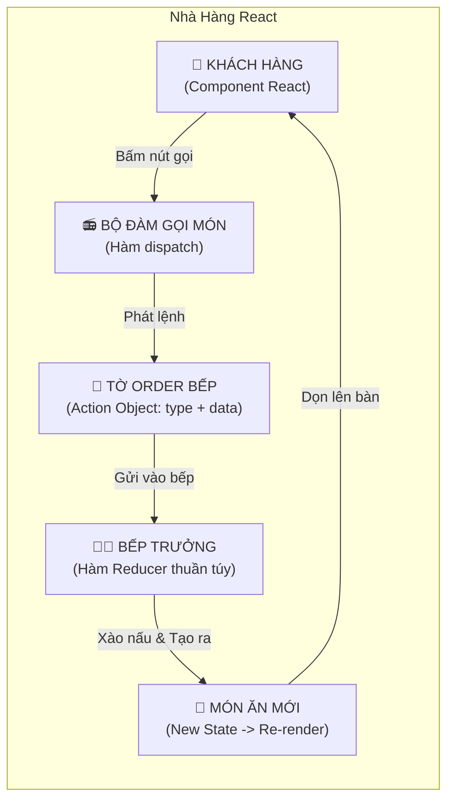
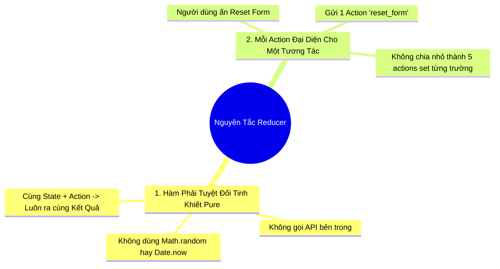

# **CHƯƠNG 3: MANAGING STATE (QUẢN LÝ TRẠNG THÁI)**
# **BÀI HỌC 21: EXTRACTING STATE LOGIC INTO A REDUCER (TRÍCH XUẤT LOGIC STATE SANG REDUCER)**

> **Hành trình: Zero to Hero React**  
> **Chủ đề:** Tách rời State Logic khỏi Component với `useReducer`; Tư duy chuyển dịch từ "Ra lệnh thao tác" sang "Phát tín hiệu hành động" (Dispatching Actions); Ẩn dụ Bếp Trưởng Nhà Hàng; Thư viện Immer với `useImmerReducer`; Tự xây dựng Hook `useReducer` từ con số 0; Giải quyết 4 thử thách của React.dev.  
> **Tài liệu tham khảo chính thức:** [React.dev - Extracting State Logic into a Reducer](https://react.dev/learn/extracting-state-logic-into-a-reducer)

---

## 🌟 TỔNG QUAN BÀI HỌC

Khi ứng dụng React của bạn lớn dần, các component quản lý danh sách hoặc biểu mẫu phức tạp thường rơi vào tình trạng **"quá tải" (Code Bloat)**:
* Bạn có 5 - 10 hàm xử lý sự kiện (`handleAdd`, `handleDelete`, `handleEdit`, `handleToggle`...).
* Trong mỗi hàm lại chứa một mớ logic copy mảng, map, filter, spread object lồng ghép chằng chịt.
* Toàn bộ mã nguồn trở nên khó đọc, khó tìm lỗi, và rất khó viết Unit Test vì logic bị trói chặt vào giao diện JSX.

> [!TIP]
> **Giải pháp chuẩn mực của React:**  
> Rút toàn bộ logic cập nhật trạng thái ra khỏi Component và gom vào **MỘT HÀM THUẦN TÚY DUY NHẤT (Pure Function)** đặt ở bên ngoài.  
> Hàm đó được gọi là **Reducer**, và Hook điều phối nó là **`useReducer`**.

---

## 1. ẨN DỤ NHÀ HÀNG: HIỂU BẢN CHẤT `useReducer` TRONG 60 GIÂY

Để hiểu luồng vận hành của `useReducer`, hãy tưởng tượng một nhà hàng cao cấp:



* **Component (Khách hàng):** Chỉ ngồi ở bàn và yêu cầu: *"Bếp ơi, tôi muốn thêm một món!"*. Component bị **tước quyền tự tay nấu nướng** (không trực tiếp gọi `setTasks(...)`).
* **Hàm `dispatch` (Bộ đàm):** Là chiếc máy liên lạc do React cấp cho Component để gửi tín hiệu đi.
* **Action (Tờ Order):** Là một JavaScript Object chứa thông tin hành động vừa diễn ra. Bắt buộc có trường `type` (Tên món/Hành động) và các dữ liệu gửi kèm (`id`, `text`...).
* **Reducer (Bếp trưởng):** Là một hàm JavaScript thuần túy nhận vào `(state, action)` và trả về `newState`. Bếp trưởng toàn quyền quyết định cách thức chế biến dữ liệu!

---

## 2. SO SÁNH TƯ DUY: `useState` VS `useReducer`

| Tiêu chí so sánh | `useState` (Mệnh Lệnh - Imperative) | `useReducer` (Khai Báo - Declarative) |
| :--- | :--- | :--- |
| **Cách tiếp cận** | Nói cho React biết **CÁCH CẬP NHẬT DỮ LIỆU** ra sao | Thông báo cho React biết **NGƯỜI DÙNG VỪA LÀM GÌ** |
| **Nơi đặt logic** | Nằm rải rác ngay bên trong các hàm xử lý sự kiện | Tập trung 100% tại một hàm `reducer` bên ngoài Component |
| **Khả năng Test (Unit Test)** | Khó test vì phải render component và bấm nút ảo | Cực kỳ dễ test: Chỉ cần gọi `reducer(state, action)` và assert kết quả |
| **Độ phức tạp code** | Ngắn gọn cho state đơn giản (1-2 biến độc lập) | Dài hơn lúc đầu, nhưng cực kỳ ngăn nắp khi logic phình to |
| **Tình huống sử dụng** | Bật/tắt modal, ô input text đơn lẻ, counter | Giỏ hàng, Todo List, Form nhiều bước, Chat app |

---

## 3. QUY TRÌNH 3 BƯỚC CHUYỂN DỊCH TỪ `useState` SANG `useReducer`

Giả sử ta đang có ứng dụng quản lý công việc (Task App). Hãy chuyển đổi nó theo 3 bước:

### Bước 1: Chuyển các lệnh `set...` thành các lời gọi `dispatch(action)`
Thay vì bảo React: *"Hãy lọc mảng tasks bỏ phần tử có id này"*, hãy dispatch một action mang tính mô tả sự kiện:

```jsx
// ❌ CŨ (useState): Ra lệnh chi tiết
function handleDeleteTask(taskId) {
  setTasks(tasks.filter(t => t.id !== taskId));
}

// ✅ MỚI (useReducer): Chỉ phát tín hiệu hành động
function handleDeleteTask(taskId) {
  dispatch({
    type: 'deleted',
    id: taskId
  });
}
```

> [!NOTE]
> **Quy ước đặt tên Action:** Trường `type` nên đặt theo thể quá khứ hoặc danh từ mô tả sự kiện người dùng vừa làm (`'added'`, `'deleted'`, `'edited_message'`), thay vì tên hàm mệnh lệnh.

---

### Bước 2: Viết hàm Reducer thuần túy
Hàm Reducer luôn nhận 2 tham số: `(state, action)` và dùng câu lệnh `switch / case`:

```javascript
// Đặt Ở NGOÀI hàm component, hoặc tách riêng ra file taskReducer.js
export function tasksReducer(tasks, action) {
  switch (action.type) {
    case 'added': {
      return [
        ...tasks,
        {
          id: action.id,
          text: action.text,
          done: false
        }
      ];
    }
    case 'changed': {
      return tasks.map(t => {
        if (t.id === action.task.id) {
          return action.task;
        }
        return t;
      });
    }
    case 'deleted': {
      return tasks.filter(t => t.id !== action.id);
    }
    default: {
      throw Error('Hành động không xác định: ' + action.type);
    }
  }
}
```

> [!TIP]
> Luôn bọc code bên trong mỗi `case` bằng dấu ngoặc nhọn `{ }` để các biến cục bộ (như `const index`) không bị đụng độ giữa các case khác nhau!

---

### Bước 3: Sử dụng Hook `useReducer` trong Component

```jsx
import { useReducer } from 'react';
import { tasksReducer } from './tasksReducer';

const initialTasks = [
  { id: 1, text: 'Học lý thuyết useReducer', done: true },
  { id: 2, text: 'Làm bài Lab tương tác số 21', done: false }
];

export default function TaskApp() {
  // Tham số 1: Hàm Reducer
  // Tham số 2: Giá trị State khởi tạo
  const [tasks, dispatch] = useReducer(tasksReducer, initialTasks);

  function handleAddTask(text) {
    dispatch({
      type: 'added',
      id: Date.now(),
      text: text
    });
  }

  function handleDeleteTask(taskId) {
    dispatch({
      type: 'deleted',
      id: taskId
    });
  }

  return (
    <div>
      <AddTask onAddTask={handleAddTask} />
      <TaskList tasks={tasks} onDeleteTask={handleDeleteTask} />
    </div>
  );
}
```

---

## 4. HAI NGUYÊN TẮC BẤT BIẾN KHI VIẾT REDUCER



1. **Reducer PHẢI là Hàm Tinh Khiết (Pure Function):**  
   Không được chứa Side Effects (không gọi `fetch()`, không đặt `setTimeout`, không ghi `localStorage`, không gọi `Math.random()`). Reducer chỉ nhận input và tính toán output bằng tư duy Bất Biến (Immutability).
2. **Mỗi Action đại diện cho MỘT tương tác người dùng:**  
   Nếu người dùng bấm nút *"Xóa tất cả và Đặt lại mặc định"*, hãy dispatch 1 action duy nhất `{ type: 'reset_all' }`. Đừng dispatch 10 action `'deleted'` nối đuôi nhau.

---

## 5. VIẾT REDUCER CỰC GỌN VỚI THƯ VIỆN IMMER (`useImmerReducer`)

Nếu bạn cảm thấy việc copy mảng và spread object nhiều tầng trong `tasksReducer` quá mỏi tay, hãy dùng `useImmerReducer` từ thư viện `use-immer`:

```jsx
import { useImmerReducer } from 'use-immer';

function tasksReducer(draft, action) {
  switch (action.type) {
    case 'added': {
      // ✅ Đột biến trực tiếp trên draft cực kỳ sướng!
      draft.push({
        id: action.id,
        text: action.text,
        done: false
      });
      break; // Chú ý: Dùng break thay vì return
    }
    case 'deleted': {
      const index = draft.findIndex(t => t.id === action.id);
      if (index !== -1) {
        draft.splice(index, 1);
      }
      break;
    }
    case 'toggled': {
      const task = draft.find(t => t.id === action.id);
      if (task) {
        task.done = !task.done;
      }
      break;
    }
  }
}
```

---

## 6. MỔ XẺ: TỰ CHẾ HOOK `useReducer` TỪ CON SỐ 0

Bản chất bên trong `useReducer` của React làm gì? Thật bất ngờ: **`useReducer` thực chất chỉ là một lớp bọc mỏng (wrapper) chạy trên nền tảng của `useState`!**

```javascript
import { useState } from 'react';

// Tự code lại Hook useReducer của React chỉ với 8 dòng mã:
export function useMyReducer(reducer, initialState) {
  const [state, setState] = useState(initialState);

  function dispatch(action) {
    // 1. Đưa state hiện tại và action vào hàm reducer tính toán
    const nextState = reducer(state, action);
    // 2. Cập nhật state bằng kết quả mới
    setState(nextState);
  }

  return [state, dispatch];
}
```

> [!IMPORTANT]
> Đoạn code trên chứng minh rõ ràng: `useReducer` không hề sở hữu phép thuật đặc biệt nào. Nó chỉ đơn giản là tách biệt phần **Tính toán Logic** (Reducer) ra khỏi phần **Lưu trữ Bộ nhớ** (`useState`).

---

## 7. LỜI GIẢI CHI TIẾT 4 BÀI TẬP THỬ THÁCH (REACT.DEV CHALLENGES)

### Thử thách 1: Dispatch actions từ các Event Handler trong Messenger App
* **Yêu cầu:** Điền code dispatch cho nút chọn liên hệ và ô soạn thảo tin nhắn.
* **Lời giải:**
  - Khi chọn liên hệ: `dispatch({ type: 'selected_contact', contactId: contact.id })`.
  - Khi gõ chữ vào textarea: `dispatch({ type: 'edited_message', message: e.target.value })`.

### Thử thách 2: Xóa trắng ô nhập liệu sau khi bấm gửi (Clear input on send)
* **Yêu cầu:** Khi bấm nút Gửi (Send), hiển thị alert tin nhắn và xóa trắng ô textarea.
* **Lời giải:**
  - Ở Component: `dispatch({ type: 'sent_message' })`.
  - Trong Reducer:
    ```javascript
    case 'sent_message': {
      return {
        ...state,
        message: '' // Xóa trắng bản nháp
      };
    }
    ```

### Thử thách 3: Khôi phục tin nhắn nháp khi chuyển đổi qua lại giữa các liên hệ
* **Vấn đề:** Gõ dở tin nhắn cho Alice, bấm sang Bob rồi quay lại Alice thì tin nhắn dở của Alice bị biến mất. Ta muốn mỗi liên hệ có một bản nháp riêng biệt.
* **Lời giải:** Chuẩn hóa State thành một Hash Map `messages`:
  ```javascript
  const initialState = {
    selectedId: 0,
    messages: {
      0: 'Xin chào Taylor',
      1: 'Xin chào Alice',
      2: 'Xin chào Bob'
    }
  };
  ```
  - Trong Reducer khi sửa tin:
  ```javascript
  case 'edited_message': {
    return {
      ...state,
      messages: {
        ...state.messages,
        [state.selectedId]: action.message // Cập nhật đúng người đang chọn
      }
    };
  }
  ```

### Thử thách 4: Viết lại Hook `useReducer` từ đầu
* **Lời giải:** Triển khai hàm `useMyReducer` bằng cách sử dụng `useState` và gọi `reducer(state, action)` bên trong hàm `dispatch` (như đã phân tích ở Mục 6).

---

## 8. BỘ CÂU HỎI PHỎNG VẤN SENIOR REACT DEVELOPER

### Q1: Khi nào bạn quyết định chuyển từ `useState` sang `useReducer` trong dự án thực tế?
* **Đáp án:**
  1. Khi một Component có **từ 3 biến State trở lên luôn thay đổi cùng nhau** (ví dụ: `isLoading`, `error`, `data`).
  2. Khi logic cập nhật State phụ thuộc phức tạp vào giá trị State trước đó (phép tính số học, duyệt mảng đa tầng).
  3. Khi muốn tách biệt hoàn toàn Business Logic ra khỏi UI để phục vụ **Unit Testing** độc lập.
  4. Khi muốn truyền hàm cập nhật xuống sâu nhiều tầng con: Truyền `dispatch` qua Context an toàn hơn nhiều so với việc truyền hàng chục hàm callback `handle...`.

### Q2: Tại sao hàm Reducer tuyệt đối không được phép gọi API (Async/Await) hay Side Effects?
* **Đáp án:**
  - Reducer được thiết kế để là một **hàm toán học thuần túy** ($y = f(x)$). Nếu gọi API trong Reducer:
    1. Reducer sẽ không thể trả về State mới ngay lập tức một cách đồng bộ (Synchronous).
    2. Khi chạy trong React 18 Concurrent Mode hoặc Strict Mode, Reducer có thể bị gọi 2 lần để kiểm tra tính thuần khiết. Việc gọi API bên trong sẽ kích hoạt **Duplicate Network Requests**.
    3. Phá vỡ tính năng **Time-travel Debugging** (tua lại lịch sử State) của các công cụ như Redux DevTools.
  - **Cách làm đúng:** Gọi API trong Event Handler hoặc `useEffect`, sau khi có dữ liệu thì mới `dispatch` action `{ type: 'fetch_success', payload: data }` vào Reducer.

### Q3: So sánh kiến trúc `useReducer + useContext` với các thư viện State Management (Redux Toolkit, Zustand)?
* **Đáp án:**
  - **`useReducer + useContext`:** Giải pháp có sẵn trong React (Built-in), không cần cài thêm gói phụ thuộc, cực kỳ lý tưởng cho các ứng dụng vừa và nhỏ hoặc quản lý state cục bộ cho một tính năng lớn (Feature-level state). Hạn chế: Không tối ưu re-render tốt khi context bị cập nhật, thiếu devtools time-travel mạnh mẽ.
  - **Zustand / Redux Toolkit:** Giải pháp toàn cục chuyên nghiệp (Global State), hỗ trợ Selector để chỉ re-render những component thực sự cần dữ liệu, tích hợp Middleware xử lý bất đồng bộ mạnh mẽ, và có hệ sinh thái DevTools hoàn chỉnh.