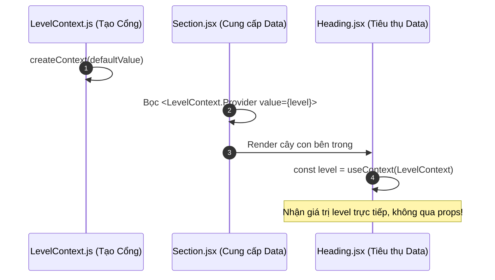
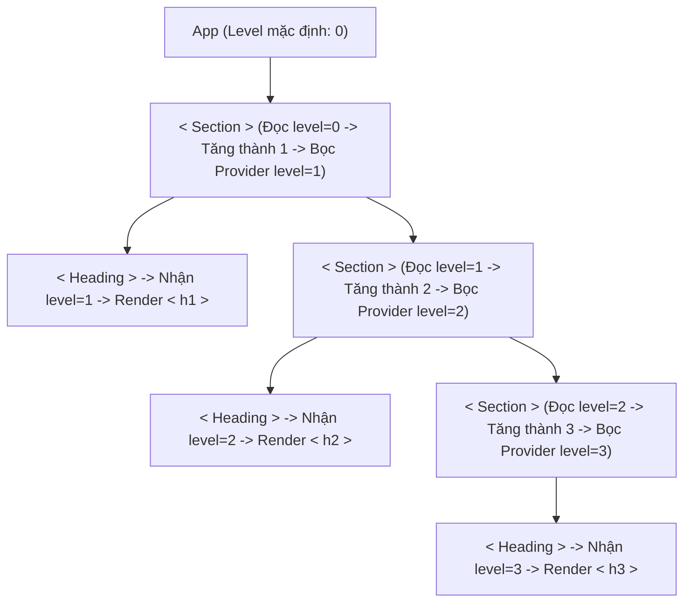

# **CHƯƠNG 3: MANAGING STATE (QUẢN LÝ TRẠNG THÁI)**
# **BÀI HỌC 22: PASSING DATA DEEPLY WITH CONTEXT (TRUYỀN DỮ LIỆU SÂU VỚI CONTEXT)**

> **Hành trình: Zero to Hero React**  
> **Chủ đề:** Hóa giải vấn nạn Prop Drilling (Khoan Prop); Cổng dịch chuyển tức thời Context API; Quy trình 3 bước Tạo - Cung cấp - Tiêu thụ Context (`useContext`); Kỹ thuật Ghi đè Context theo tầng (Context Shadowing / Overriding); Cạm bẫy hiệu năng Re-render và Chiến thuật phân tách Context; Giải quyết Thử thách chính thức của React.dev.  
> **Tài liệu tham khảo chính thức:** [React.dev - Passing Data Deeply with Context](https://react.dev/learn/passing-data-deeply-with-context)

---

## 🌟 TỔNG QUAN BÀI HỌC

Trong các bài học trước, chúng ta đã nắm vững nguyên tắc: **Dữ liệu trong React chảy một chiều từ Trên xuống Dưới (Top-Down) thông qua Props**.  
Cách làm này rất tường minh, dễ theo dõi, nhưng sẽ biến thành một **"cơn ác mộng bảo trì"** khi cây Component của bạn có độ sâu 4-5 tầng trở lên:
* Một biến trạng thái (như `currentUser`, `theme`, `imageSize`) cần được dùng ở tầng thứ 5 (nút Lá).
* Tất cả 4 component trung gian ở giữa **hoàn toàn không cần đến dữ liệu đó**, nhưng vẫn bắt buộc phải khai báo prop và chuyền tiếp xuống dưới.
* Hiện tượng này gọi là **Prop Drilling** (Khoan Prop qua nhiều tầng lầu).

> [!TIP]
> **Giải pháp tối thượng của React:**  
> **Context API** đóng vai trò như một **"Cổng dịch chuyển tức thời" (Teleportation Gateway)**.  
> Component Cha cấp cao chỉ cần phát sóng dữ liệu vào Context. Bất kỳ component con, cháu, chắt nào ở sâu bên dưới đều có thể "thò tay" vào lấy trực tiếp bằng Hook **`useContext`**, bỏ qua hoàn toàn các tầng trung gian!

---

## 1. BẢN CHẤT: VẤN NẠN "PROP DRILLING" VS CỔNG DỊCH CHUYỂN CONTEXT

```mermaid
graph TD
    subgraph SAI: Prop Drilling (Khoan qua các tầng vô nghĩa)
        A1[App: Chứa theme='dark'] -->|theme| B1[Layout: Không dùng theme]
        B1 -->|theme| C1[Sidebar: Không dùng theme]
        C1 -->|theme| D1[UserProfile: Không dùng theme]
        D1 -->|theme| E1[ThemeToggle: Thực sự cần theme!]
    end

    subgraph ĐÚNG: Context API (Dịch chuyển tức thời)
        A2[App: Bọc ThemeContext.Provider]
        A2 -.->|Teleport xuyên không gian| E2[ThemeToggle: useContext ThemeContext]
        A2 --> B2[Layout: Không cần khai báo prop]
        B2 --> C2[Sidebar: Không cần khai báo prop]
        C2 --> D2[UserProfile: Không cần khai báo prop]
        D2 --> E2
    end

    style A1 fill:#3b82f6,color:#ffffff
    style E1 fill:#ef4444,color:#ffffff
    style A2 fill:#10b981,color:#ffffff
    style E2 fill:#10b981,color:#ffffff
```

### So sánh trực quan:
* **Prop Drilling:** Giống như bạn muốn đưa một cốc trà sữa từ tầng 10 xuống cho nhân viên bảo vệ ở tầng 1 của tòa nhà, nhưng tòa nhà không có thang máy: Bạn phải nhờ nhân viên tầng 9 chuyển cho tầng 8, rồi tầng 7, tầng 6... vừa mất công, vừa dễ nhầm lẫn.
* **Context API:** Tòa nhà lắp một đường ống vận chuyển khí nén siêu tốc xuyên qua các tầng. Tầng 10 thả cốc trà sữa vào ống, tầng 1 bấm nút mở ống lấy ra ngay lập tức!

---

## 2. QUY TRÌNH 3 BƯỚC CHUẨN MỰC SỬ DỤNG CONTEXT

Để triển khai Context trong React, bạn luôn thực hiện theo đúng 3 bước:



### Bước 1: Tạo Context (Create Context)
Tách một file riêng (ví dụ `ThemeContext.js`) để khởi tạo Context và xuất ra ngoài:

```javascript
import { createContext } from 'react';

// Tham số truyền vào là GIÁ TRỊ MẶC ĐỊNH (Default Value)
// Giá trị này chỉ được dùng khi một component gọi useContext mà KHÔNG nằm bên trong Provider nào!
export const ThemeContext = createContext('light');
```

---

### Bước 2: Cung cấp Context (Provide Context)
Tại Component Cha (nơi nắm giữ dữ liệu), bọc thẻ Provider quanh vùng cây cần chia sẻ dữ liệu và truyền giá trị vào prop `value`:

```jsx
import { useState } from 'react';
import { ThemeContext } from './ThemeContext';
import PageContent from './PageContent';

export default function App() {
  const [theme, setTheme] = useState('dark');

  return (
    // Bọc Provider và ném dữ liệu vào prop value:
    <ThemeContext.Provider value={theme}>
      <PageContent />
    </ThemeContext.Provider>
  );
}
```

> [!NOTE]
> Trong React 19 mới nhất, bạn có thể viết ngắn gọn `<ThemeContext value={theme}>` thay vì `<ThemeContext.Provider value={theme}>`. Tuy nhiên, cú pháp `.Provider` vẫn tương thích 100% trên mọi phiên bản React 16.8+ đến 18+.

---

### Bước 3: Tiêu thụ Context (Consume Context)
Tại bất kỳ Component con/cháu nào cần dữ liệu, import Context và gọi Hook `useContext`:

```jsx
import { useContext } from 'react';
import { ThemeContext } from './ThemeContext';

export default function Button() {
  // Thò tay vào cổng lấy giá trị theme ra dùng:
  const theme = useContext(ThemeContext);

  return (
    <button className={`btn btn-${theme}`}>
      Nút bấm theo chủ đề: {theme}
    </button>
  );
}
```

---

## 3. CONTEXT SHADOWING (GHI ĐÈ CONTEXT THEO TẦNG LỒNG NHAU)

Một trong những tính năng kỳ diệu nhất của Context là **Cơ chế ghi đè (Shadowing / Overriding)**:
Khi bạn lồng nhiều Provider cùng loại vào nhau, component con sẽ luôn luôn đọc dữ liệu từ **Provider gần nó nhất trong cây DOM** (giống hệt cơ chế ghi đè biến trong phạm vi khối lệnh JavaScript).

### Case Study Kinh Điển: Hệ thống Tiêu Đề Tự Động Thích Ứng (Adaptive Headings)

Hãy tưởng tượng bạn xây dựng các thẻ `<Heading>` và `<Section>`. Bạn muốn:
* Ở tầng ngoài cùng: `<Heading>` tự động là `<h1>`.
* Bên trong 1 `<Section>`: `<Heading>` tự động biến thành `<h2>`.
* Bên trong `<Section>` lồng thêm `<Section>`: `<Heading>` tự động là `<h3>`.
* Bạn **không muốn phải gõ thủ công** `<Heading level={3}>` khắp nơi!



#### Triển khai code chuẩn xác:

```jsx
// LevelContext.js
export const LevelContext = createContext(0);

// Section.jsx
export function Section({ children }) {
  // 1. Đọc level của cha phía trên
  const parentLevel = useContext(LevelContext);
  // 2. Tự tăng lên 1 cho thế hệ con
  const currentLevel = parentLevel + 1;

  return (
    <section className="section-box">
      <LevelContext.Provider value={currentLevel}>
        {children}
      </LevelContext.Provider>
    </section>
  );
}

// Heading.jsx
export function Heading({ children }) {
  const level = useContext(LevelContext);
  switch (level) {
    case 1: return <h1>{children}</h1>;
    case 2: return <h2>{children}</h2>;
    case 3: return <h3>{children}</h3>;
    case 4: return <h4>{children}</h4>;
    default: return <h6>{children}</h6>;
  }
}
```

Nhờ Context Shadowing, bạn chỉ cần lồng các thẻ `<Section>` tự nhiên trong JSX, toàn bộ thẻ `<Heading>` bên trong sẽ **tự động tính toán đúng cấp độ** mà không cần truyền bất kỳ một dòng prop nào!

---

## 4. DYNAMIC CONTEXT: TRUYỀN CẢ STATE VÀ SETTER VÀO CONTEXT

Context không chỉ truyền dữ liệu đọc tĩnh (`read-only`). Bạn có thể truyền cả một Object chứa biến State và hàm Setter để các Component con ở bất kỳ đâu cũng có thể kích hoạt thay đổi dữ liệu:

```jsx
export const AuthContext = createContext(null);

export function AuthProvider({ children }) {
  const [user, setUser] = useState(null);

  const login = (userData) => setUser(userData);
  const logout = () => setUser(null);

  return (
    <AuthContext.Provider value={{ user, login, logout }}>
      {children}
    </AuthContext.Provider>
  );
}
```

Ở bất kỳ nút bấm con nào trong ứng dụng:
```jsx
function LogoutButton() {
  const { user, logout } = useContext(AuthContext);
  if (!user) return null;
  return <button onClick={logout}>Đăng xuất ({user.name})</button>;
}
```

---

## 5. KHI NÀO NÊN DÙNG VÀ KHI NÀO NÊN TRÁNH CONTEXT?

Context rất tiện lợi, nhưng đi kèm với một cái giá đắt nếu bị lạm dụng bừa bãi:

### ❌ KHÔNG NÊN DÙNG CONTEXT KHI:
1. **Dữ liệu chỉ truyền qua 1 - 2 tầng:** Hãy chịu khó dùng Props. Truyền Props giúp code cực kỳ tường minh (mở file ra là biết dữ liệu từ đâu tới). Context làm "ẩn" đi luồng dữ liệu, khiến việc debug khó khăn hơn.
2. **Có thể giải quyết bằng Component Composition:**  
   Nếu bạn chỉ muốn tránh chuyền prop qua các tầng trung gian, hãy đưa component con lên Cha và truyền qua prop `children`:
   ```jsx
   // Thay vì khoan prop avatar qua Page -> Layout -> Header:
   <Page>
     <Layout header={<Header avatar={<Avatar src={user.avatar} />} />} />
   </Page>
   ```

### ✅ NÊN DÙNG CONTEXT KHI:
1. **Theming (Giao diện):** Đổi màu Light / Dark mode toàn ứng dụng.
2. **Current User / Auth Session:** Thông tin đăng nhập, phân quyền Role (Admin, Editor, Member), Token bảo mật.
3. **Routing:** Khung nhìn đường dẫn hiện tại (như React Router `useLocation`, `useNavigate`).
4. **Localization (Đa ngôn ngữ):** Ngôn ngữ hiện tại (Việt, Anh, Nhật) và từ điển dịch thuật `t('welcome')`.
5. **Managing State kết hợp Reducer:** Truyền hàm `dispatch` của Reducer đi khắp ứng dụng mà không cần chuyền callback qua từng tầng.

---

## 6. CẠM BẪY HIỆU NĂNG: CONTEXT RE-RENDER TRAP VÀ CÁCH PHÒNG TRÁNH

### 6.1 Cạm bẫy Re-render hàng loạt
> [!WARNING]
> Khi giá trị `value` của Context Provider thay đổi tham chiếu (`Object.is(oldValue, newValue) === false`), **TẤT CẢ CÁC COMPONENT GỌI `useContext` ĐÓ ĐỀU BỊ KÍCH HOẠT RE-RENDER**, bất kể chúng có sử dụng trường dữ liệu bị thay đổi hay không!

Nếu bạn gom cả thông tin người dùng (`user`) và đồng hồ đếm giây (`seconds`) vào cùng 1 Context:
* Cứ mỗi 1 giây đồng hồ nhảy, toàn bộ Navbar, Sidebar, Footer, Profile Card đều bị render lại vô ích!

### 6.2 Chiến thuật tối ưu hóa chuẩn Senior:
1. **Tách biệt Context (Split Contexts):** Chia nhỏ dữ liệu thành các Context độc lập:
   - `UserContext`: Chỉ chứa dữ liệu người dùng (hiếm khi thay đổi).
   - `ClockContext`: Chứa dữ liệu nhảy giây (thay đổi liên tục).
2. **Tách riêng Data và Dispatch:**
   - `TasksContext`: Chứa danh sách công việc.
   - `TasksDispatchContext`: Chỉ chứa hàm `dispatch` (hàm này không bao giờ đổi tham chiếu, giúp các nút bấm không bị re-render thừa).
3. **Bọc giá trị bằng `useMemo`:**
   ```jsx
   const contextValue = useMemo(() => ({ user, login, logout }), [user]);
   return <AuthContext.Provider value={contextValue}>{children}</AuthContext.Provider>;
   ```

---

## 7. LỜI GIẢI CHI TIẾT THỬ THÁCH CHÍNH THỨC (REACT.DEV CHALLENGE)

### Thử thách 1: Thay thế Prop Drilling bằng Context (Image Size Zoom)
* **Hiện tượng ban đầu:** Trong ứng dụng danh sách địa danh, biến `imageSize` (kích thước ảnh) bị khoan qua 4 tầng:
  `App` $\rightarrow$ `List` $\rightarrow$ `Place` $\rightarrow$ `PlaceImage`.
  Các component `List` và `Place` không hề dùng `imageSize` nhưng vẫn phải nhận và chuyền prop.
* **Lời giải chuẩn mực:**
  1. Tạo `ImageSizeContext.js`:
     ```javascript
     import { createContext } from 'react';
     export const ImageSizeContext = createContext(100);
     ```
  2. Bọc Provider ở `App.jsx`:
     ```jsx
     <ImageSizeContext.Provider value={imageSize}>
       <List />
     </ImageSizeContext.Provider>
     ```
  3. Xóa sạch prop `imageSize` ở khai báo hàm của `List` và `Place`.
  4. Tại `PlaceImage.jsx`, lấy trực tiếp kích thước:
     ```jsx
     const imageSize = useContext(ImageSizeContext);
     return ;
     ```

---

## 8. BỘ CÂU HỎI PHỎNG VẤN SENIOR REACT DEVELOPER

### Q1: Điều gì xảy ra nếu một Component gọi `useContext(MyContext)` nhưng không được bọc bởi bất kỳ `<MyContext.Provider>` nào ở phía trên?
* **Đáp án:** Component sẽ nhận được **Giá trị mặc định (Default Value)** được truyền vào hàm `createContext(defaultValue)` lúc khởi tạo. Nếu không truyền giá trị mặc định, nó sẽ nhận `undefined`. Ứng dụng **không hề bị crash**. Tính năng này rất hữu ích khi viết Unit Test độc lập cho component con mà không cần mock Provider.

### Q2: Tại sao React Context không được coi là một công cụ Quản lý State toàn diện (State Management Tool) mà chỉ là cơ chế Truyền tải (Dependency Injection)?
* **Đáp án:** Context bản thân nó **không hề quản lý hay lưu trữ State**. Nó chỉ là một "ống dẫn" giúp dữ liệu được truyền từ điểm A đến điểm B trong cây DOM. Muốn có State, bạn vẫn phải kết hợp Context với `useState` hoặc `useReducer`. Ngoài ra, Context thiếu các tính năng nâng cao của State Manager thực thụ như: Middleware xử lý bất đồng bộ, Selector tối ưu re-render từng phần tử, và Time-travel Debugging.

### Q3: Làm thế nào để ngăn chặn một Component con bị Re-render khi Context thay đổi nếu nó chỉ cần một phần nhỏ dữ liệu trong Context?
* **Đáp án:**
  1. **Tách Context:** Phân nhỏ Context lớn thành nhiều Context nhỏ có trách nhiệm đơn nhất (Single Responsibility).
  2. **Chia tách Component thành 2 phần:** Phần ngoài đọc Context và truyền phần dữ liệu cần thiết qua Props vào phần trong được bọc bởi `React.memo`.
  3. **Sử dụng thư viện chuyên dụng:** Dùng các thư viện hỗ trợ Context Selector (như `use-context-selector`) hoặc chuyển sang dùng **Zustand** (hỗ trợ `useStore(state => state.specificField)`).