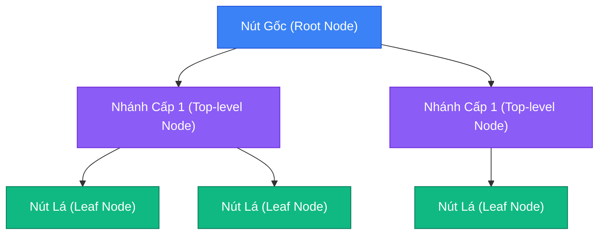
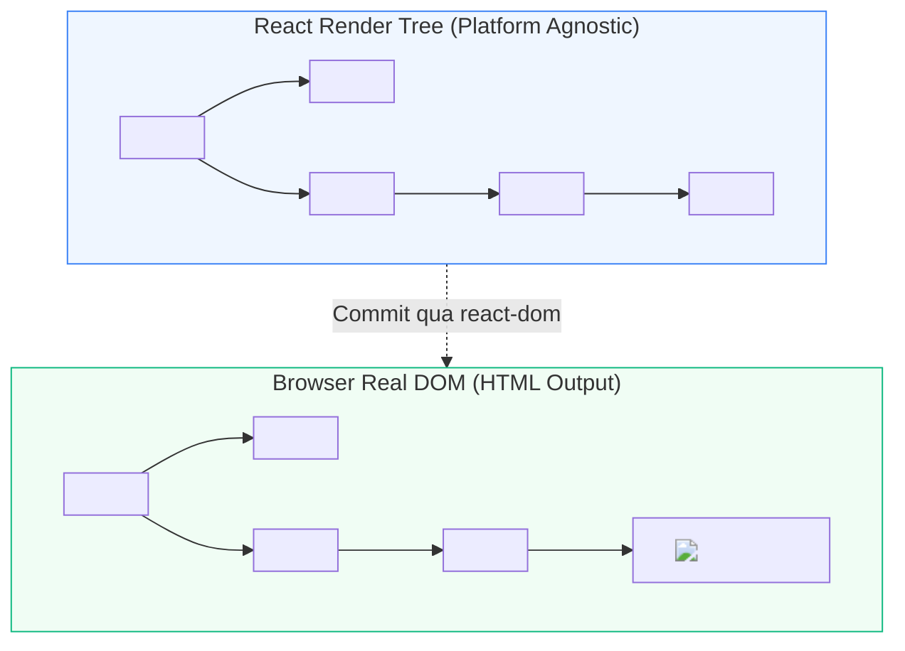
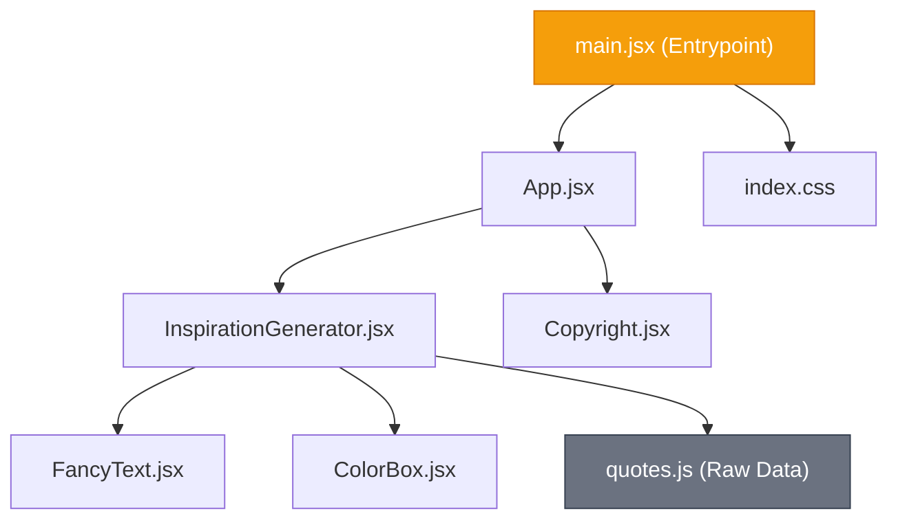
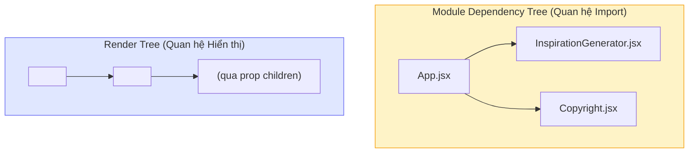

# **BÀI HỌC 9: UNDERSTANDING YOUR UI AS A TREE (HIỂU GIAO DIỆN DƯỚI DẠNG CÂY)**

> **Hành trình: Zero to Hero React**  
> **Chủ đề:** Xây dựng mô hình tư duy (Mental Model) về mối quan hệ giữa các Component và Tập tin mã nguồn thông qua Cấu trúc Cây.  
> **Tài liệu tham khảo chính thức:** [React.dev - Understanding Your UI as a Tree](https://react.dev/learn/understanding-your-ui-as-a-tree)

---

## 🌟 TỔNG QUAN BÀI HỌC

Trong lập trình React, giao diện của bạn không phải là một chuỗi các thẻ HTML rời rạc hay một danh sách phẳng các hàm JavaScript. React nhìn nhận toàn bộ ứng dụng của bạn dưới dạng **Cấu trúc Cây (Tree)**.

Việc hiểu sâu cấu trúc cây mang lại 3 lợi thế cốt tử:
1. **Kiểm soát luồng dữ liệu (Data Flow):** Hiểu rõ cách Props truyền từ trên xuống (Top-down) và State được nâng lên (Lifting State Up).
2. **Tối ưu hóa hiệu năng Render:** Dự đoán chính xác nhánh nào sẽ bị vẽ lại khi một component thay đổi trạng thái, tránh hiện tượng Re-render dây chuyền (Cascade Re-renders).
3. **Kiểm soát dung lượng đóng gói (Bundle Size):** Hiểu cách các công cụ đóng gói (Bundlers như Vite/Webpack) bóc tách mã nguồn và loại bỏ mã thừa (Tree Shaking).

---

## 1. BẢN CHẤT: CẤU TRÚC CÂY TRONG KHOA HỌC MÁY TÍNH VÀ GIAO DIỆN

### 1.1. Tại sao lại là Cây (Tree)?
Trong khoa học máy tính, cấu trúc dữ liệu Cây (Tree) là mô hình tự nhiên và hiệu quả nhất để biểu diễn mối quan hệ **phân cấp phụ thuộc (hierarchical relationships)**:
- **Trình duyệt Web:** Dựng cây **DOM** (Document Object Model) cho cấu trúc HTML và cây **CSSOM** cho định dạng CSS.
- **Hệ điều hành di động (iOS / Android):** Quản lý giao diện qua hệ thống phân cấp View (UIView Hierarchy / ViewGroup).
- **Thư viện React:** Sử dụng mô hình cây để theo dõi quan hệ giữa các Component và sự biến đổi của giao diện qua từng lần render.



---

## 2. CÂY RENDER (THE RENDER TREE)

### 2.1. Khái niệm và đặc điểm cốt lõi
**Cây Render (Render Tree)** là mô hình biểu diễn mối quan hệ **Cha - Con (Parent - Child)** giữa các React Component được thực thi trong **một lần render duy nhất (a single render pass)**.

- **Nút Gốc (Root Component):** Thường là component cao nhất của ứng dụng (ví dụ `<App />`). Đây là điểm khởi đầu cho mọi quá trình render.
- **Top-level Components (Component tầng trên):** Các component nằm gần gốc. Chúng đóng vai trò điều phối layout, cung cấp Context hoặc quản lý State tổng thể.
  > ⚠️ **Lưu ý hiệu năng:** Khi một Top-level component bị re-render, mặc định toàn bộ các component con cháu bên dưới cây đều sẽ bị đánh giá lại!
- **Leaf Components (Component lá):** Các component nằm ở đáy cùng của cây, không chứa component con nào khác (ví dụ `<Button />`, `<Avatar />`, `<Badge />`). Chúng thường nhận props để hiển thị trực tiếp và có tần suất cập nhật cao nhưng chi phí render rẻ.

### 2.2. Deep Dive: Tại sao thẻ HTML (`<h1>`, `<div>`) KHÔNG xuất hiện trong Render Tree của React?
Đây là câu hỏi phỏng vấn kinh điển nhằm phân biệt người hiểu bản chất và người học vẹt:
1. **React là thư viện độc lập với nền tảng (Platform Agnostic):** React được thiết kế để render ra Web (`react-dom`), Ứng dụng di động iOS/Android (`react-native`), hoặc thậm chí Terminal (`ink`), 3D Canvas (`react-three-fiber`).
2. **Cây Render của React đứng ở tầng trừu tượng cao hơn:** Render Tree chỉ theo dõi các **React Component** do bạn hoặc thư viện định nghĩa.
3. Khi chạy trên trình duyệt, thư viện cầu nối `react-dom` sẽ chuyển đổi các mô tả JSX tương ứng thành các thẻ HTML trên Real DOM. Vì vậy, thẻ HTML chỉ là sản phẩm đích (output) của quá trình commit, không phải là nút trong Render Tree của React.



### 2.3. Tính biến động theo điều kiện (Dynamic Across Renders)
Không giống như cấu trúc tệp mã nguồn cố định, **Render Tree thay đổi liên tục theo từng lần render** tùy thuộc vào logic điều kiện (**Conditional Rendering**):

```jsx
export default function InspirationGenerator({ type }) {
  return (
    <div>
      <Header />
      {type === 'quote' ? <FancyText /> : <ColorBox />}
      <Footer />
    </div>
  );
}
```

- **Khi `type === 'quote'`:** Render Tree có nhánh `InspirationGenerator` $\rightarrow$ `FancyText`.
- **Khi `type === 'color'`:** Nhánh `FancyText` bị gỡ bỏ (unmount) và thay thế bằng nhánh `InspirationGenerator` $\rightarrow$ `ColorBox`.
- Render Tree luôn là một **ảnh chụp nhanh (snapshot)** tại đúng thời điểm hiển thị đó.

---

## 3. CÂY PHỤ THUỘC MÔ-ĐUN (THE MODULE DEPENDENCY TREE)

### 3.1. Khái niệm và Quy tắc hình thành
Song song với Render Tree, công cụ đóng gói (Bundler như Vite, Webpack, Rollup) và môi trường thực thi JavaScript theo dõi ứng dụng qua **Cây phụ thuộc mô-đun (Module Dependency Tree)**.

- **Nút (Nodes):** Mỗi nút là một **tập tin mã nguồn (Module file)**, có thể là `.jsx`, `.js`, `.ts`, `.css`, hoặc `.json`.
- **Cạnh / Nhánh (Edges):** Biểu diễn cho một câu lệnh **`import`** hoặc `require()`.
- **Điểm vào (Entrypoint):** Tệp khởi động của ứng dụng (thường là `main.jsx` hoặc `index.js`).



### 3.2. Vai trò đối với Bundler và Cơ chế Tree-Shaking
1. **Đóng gói mã nguồn (Bundling):** Bundler xuất phát từ file `main.jsx`, lần theo tất cả các đường dẫn `import` để gom tất cả các tệp cần thiết thành các gói JavaScript tinh gọn (bundles) gửi tới trình duyệt người dùng.
2. **Rung cây loại bỏ mã chết (Tree Shaking):**
   - Nếu bạn tạo một tệp `unusedHelper.js` nhưng **không có tệp nào `import` nó**, tệp đó sẽ không xuất hiện trên Dependency Tree.
   - Khi chạy lệnh `npm run build`, Bundler sẽ tự động cắt tỉa (shake off) tệp này ra khỏi sản phẩm cuối, giúp giảm đáng kể kích thước tải trang (Bundle Size).
3. **Phát hiện lỗi nhập phụ thuộc vòng (Circular Dependencies):** Giúp lập trình viên phát hiện khi File A import File B và File B lại import ngược lại File A.

---

## 4. SO SÁNH CỐT LÕI: RENDER TREE VS MODULE DEPENDENCY TREE

Hai loại cây này tuy cùng xuất phát từ một dự án nhưng phục vụ hai mục đích hoàn toàn khác biệt:

| Tiêu chí | Cây Render (Render Tree) | Cây Phụ thuộc Mô-đun (Dependency Tree) |
|:---|:---|:---|
| **Bản chất của Nút (Nodes)** | Các **React Component** đang thực thi | Các **Tệp tin mã nguồn** (.jsx, .js, .css, .json) |
| **Bản chất của Nhánh (Edges)** | Quan hệ hiển thị Cha render Con (`renders`) | Quan hệ mã nguồn Tệp này nạp Tệp kia (`imports`) |
| **Chứa tệp không phải UI?** | ❌ **Không** (chỉ chứa Component) | ✅ **Có** (chứa cả CSS, utils, data JSON, images) |
| **Xử lý với prop `children`** | Component con xuất hiện dưới Component bao bọc nó | Tệp con phụ thuộc vào nơi trực tiếp viết lệnh `import` |
| **Tính biến động (Dynamic)** | **Thay đổi liên tục** theo State và điều kiện logic | **Cố định tĩnh** dựa trên cấu trúc các câu lệnh import |
| **Trọng tâm ứng dụng** | Tối ưu hóa hiệu năng render, quản lý State | Kiểm soát Bundle Size, Code Splitting, Tree Shaking |

---

## 5. HIỆN TƯỢNG VỚI PROP `CHILDREN`: SỰ LỆCH PHA GIỮA 2 LOẠI CÂY

Xét cấu trúc kinh điển sau:

```jsx
// App.jsx
import InspirationGenerator from './InspirationGenerator';
import Copyright from './Copyright';

export default function App() {
  return (
    <InspirationGenerator>
      <Copyright year={2026} />
    </InspirationGenerator>
  );
}
```

```jsx
// InspirationGenerator.jsx
export default function InspirationGenerator({ children }) {
  return (
    <div className="box">
      <h2>Ý tưởng hôm nay</h2>
      {children}
    </div>
  );
}
```

### Phân tích sự khác biệt:
1. **Trên Module Dependency Tree:**
   - `App.jsx` import trực tiếp `Copyright.jsx`.
   - `InspirationGenerator.jsx` **hoàn toàn KHÔNG import** `Copyright.jsx`.
   - $\rightarrow$ Trên cây phụ thuộc: `Copyright.jsx` là nhánh con của `App.jsx`.
2. **Trên Render Tree:**
   - `InspirationGenerator` nhận `<Copyright />` thông qua prop `children` và hiển thị nó bên trong JSX của mình.
   - $\rightarrow$ Trên cây render: `<Copyright />` xuất hiện với tư cách là **con trực tiếp** nằm dưới `<InspirationGenerator />`.



> 💡 **Ý nghĩa kiến trúc cao cấp (Architectural Decoupling):**
> Kỹ thuật dùng prop `children` cho phép bạn đưa một component con vào sâu trong giao diện mà **không làm cho component bao bọc ngoài bị phụ thuộc mã nguồn**. Điều này giúp tạo ra các Layout Component cực kỳ linh hoạt, tái sử dụng cao và dễ bảo trì!

---

## 6. 🌱 GÓC NHÌN ĐỐI CHIẾU BACKEND (JAVA / SPRING BOOT)

Đối với các kỹ sư quen thuộc với kiến trúc Backend Java/Spring Boot, các khái niệm cây trong React có sự tương đồng sâu sắc:

| Khái niệm React | Mô hình tương đương trong Java / Spring Boot | Bản chất kiến trúc |
|:---|:---|:---|
| **Render Tree** | **Spring ApplicationContext Bean Hierarchy / Composite Pattern** | Mô hình quan hệ giữa các đối tượng đang chạy trong Runtime. Bean cha quản lý vòng đời và phạm vi (Scope) của các Bean con. |
| **Module Dependency Tree** | **Maven / Gradle Dependency Graph (`pom.xml` / `build.gradle`)** | Cây quan hệ tĩnh giữa các module/thư viện để trình biên dịch đóng gói ra tệp JAR/WAR sản phẩm. |
| **Tree Shaking** | **Dead Code Elimination / ProGuard / Spring Native AOT Reachability** | Quét cây phụ thuộc tĩnh để gỡ bỏ toàn bộ Class/Method không được sử dụng nhằm giảm kích thước Docker Image / Binary. |
| **Prop `children` Decoupling** | **Dependency Injection (Inversion of Control - IoC)** | Thay vì Class A tự khởi tạo Class B (`new B()`), Class A nhận Interface của B qua Constructor. Giảm coupling, tăng testability. |
| **Top-level Components** | **Root `@Configuration` / Gateway Controller** | Nút đầu mối quan trọng; thay đổi cấu hình tại đây sẽ ảnh hưởng lan truyền xuống toàn bộ hệ thống bên dưới. |

---

## 7. QUÁ TRÌNH "RENDER" TRONG REACT KHÁC GÌ SO VỚI HTML TRUYỀN THỐNG?

| Tiêu chí | HTML truyền thống (Trình duyệt) | React Component Tree |
|:---|:---|:---|
| **Bản chất của "Render"** | Quá trình tính toán Layout, đổ bóng và vẽ màu điểm ảnh (Painting) lên màn hình thật | Quá trình **gọi các hàm Component để tính toán bản vẽ JSX (Virtual DOM)** trong bộ nhớ RAM |
| **Vị trí thực thi** | Luôn trực tiếp trên Real DOM của trình duyệt | Tính toán trong RAM (Pha Render), sau đó chỉ cập nhật điểm khác biệt sang Real DOM (Pha Commit) |
| **Chi phí tài nguyên** | Rất tốn kém (Trigger Layout / Reflow / Repaint trên Real DOM) | Cực nhanh vì so sánh đối tượng JavaScript thuần túy trong RAM |
| **Cơ chế cập nhật** | Thường sửa thủ công từng phần tử DOM (`innerHTML`, jQuery) hoặc tải lại trang | Tự động đối chiếu (Reconciliation / Diffing) và vá lỗi chính xác (Targeted Patching) |

---

## 8. 🎯 BỘ CÂU HỎI PHỎNG VẤN CHUYÊN SÂU (INTERVIEW Q&A)

### Câu 1: Tại sao việc phân biệt Render Tree và Module Dependency Tree lại quan trọng khi tối ưu hóa hiệu năng?
**Trả lời:**
- Khi tối ưu **thời gian tải trang ban đầu (First Load Time)**, ta cần can thiệp vào **Module Dependency Tree**: tối ưu dung lượng bundle, áp dụng Code Splitting (`React.lazy`, Dynamic Imports) và Tree Shaking để loại bỏ các tệp không cần thiết.
- Khi tối ưu **độ mượt mà khi người dùng tương tác (Runtime Performance)**, ta cần can thiệp vào **Render Tree**: tối ưu vị trí đặt State, tránh re-render lan truyền từ các Top-level components, sử dụng `React.memo` hoặc đưa component xuống làm `children` để ngắt chuỗi render.

### Câu 2: Giả sử Component `A` bao bọc Component `B` bằng prop `children`. Khi `A` re-render do State nội bộ thay đổi, `B` có bị re-render không? Tại sao?
**Trả lời:**
**Không (nếu bản thân component cha của `A` không re-render).**  
Bởi vì đối tượng JSX của `B` đã được tạo ra ở component cha (ví dụ `App`) và truyền vào `A` dưới dạng prop `children`. Khi chỉ có State của `A` thay đổi, hàm `App` không chạy lại, do đó prop `children` giữ nguyên tham chiếu đối tượng cũ. React nhận thấy tham chiếu của `children` không đổi nên sẽ bỏ qua việc re-render `B`. Đây là một pattern tối ưu hiệu năng kinh điển mà không cần dùng `React.memo`!

### Câu 3: Làm thế nào để Bundler thực hiện được Tree Shaking trong dự án React?
**Trả lời:**
Tree Shaking dựa hoàn toàn vào cú pháp **ES Modules tĩnh (Static ES Modules: `import` và `export`)**. Khác với `require()` của CommonJS có thể gọi động trong hàm hay câu lệnh `if`, cú pháp `import` của ESM luôn nằm cố định ở đầu tệp, cho phép Bundler phân tích cấu trúc cây phụ thuộc trước khi chạy mã (Static Analysis). Bất kỳ tệp hoặc hàm export nào không có đường liên kết trong cây import sẽ được loại bỏ hoàn toàn trong bản build production.

---

## 9. TỔNG KẾT BÀI HỌC (RECAP)

1. Giao diện người dùng trong React là một **cấu trúc cây**.
2. **Render Tree** đại diện cho quan hệ lồng nhau giữa các Component trong một lần hiển thị; thay đổi linh hoạt theo điều kiện; giúp tối ưu luồng State và Render.
3. **Module Dependency Tree** đại diện cho quan hệ `import` giữa các file; có cấu trúc tĩnh; giúp Bundler tối ưu hóa dung lượng file (Tree Shaking, Bundling).
4. Prop **`children`** là chìa khóa kiến trúc tạo nên sự linh hoạt, phân tách quan hệ hiển thị khỏi quan hệ phụ thuộc mã nguồn (Decoupling).