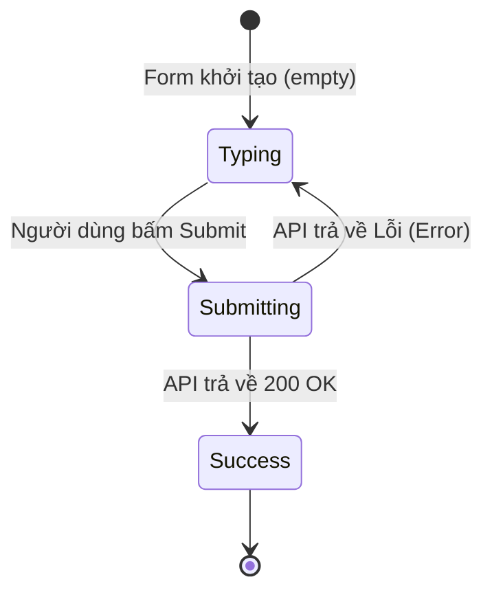

# **CHƯƠNG 3: MANAGING STATE (QUẢN LÝ TRẠNG THÁI)**
# **BÀI HỌC 17: REACTING TO INPUT WITH STATE (TƯ DUY LẬP TRÌNH KHAI BÁO UI)**

> **Hành trình: Zero to Hero React**  
> **Chủ đề:** Sự chuyển dịch tư duy từ Lập trình Mệnh lệnh (Imperative) sang Lập trình Khai báo (Declarative); Quy trình 5 bước mô hình hóa UI; Triệt tiêu Nghịch lý State (State Paradoxes); Mô hình Máy trạng thái hữu hạn (FSM).  
> **Tài liệu tham khảo chính thức:** [React.dev - Reacting to Input with State](https://react.dev/learn/reacting-to-input-with-state)

---

## 🌟 TỔNG QUAN BÀI HỌC

Bài học này đánh dấu bước chuyển sang **Chương 3: Managing State** — một trong những chương cốt lõi nhất của toàn bộ hành trình trở thành React Developer chuyên nghiệp.

Khi lập trình web bằng JavaScript thuần (Vanilla JS) hoặc jQuery, chúng ta đã quá quen với việc ra lệnh trực tiếp cho trình duyệt: *"Khi người dùng click, hãy tìm thẻ input có id này, disable nó đi, hiện thẻ spinner loading, ẩn thông báo lỗi..."*. 

Cách tiếp cận này được gọi là **Lập trình Mệnh lệnh (Imperative UI)**. Nó hoạt động tốt với các trang web đơn giản, nhưng trở thành một cơn ác mộng kiến trúc khi hệ thống mở rộng, dẫn đến hàng loạt lỗi đồng bộ giao diện.

React giải quyết triệt để vấn đề này bằng triết lý **Lập trình Khai báo (Declarative UI)**: Bạn không bao giờ ra lệnh cho DOM thay đổi. Bạn chỉ cần mô tả giao diện sẽ trông như thế nào ở từng trạng thái, và React sẽ tự động làm phần việc còn lại.

---

## 1. SO SÁNH BẢN CHẤT: IMPERATIVE VS DECLARATIVE

### 1.1 Ẩn dụ Đi Xe Taxi
* **Lập trình Mệnh lệnh (Imperative):** Bạn ngồi vào taxi và liên tục chỉ đạo tài xế từng mét đường: *"Anh đi thẳng 50m, bật xi-nhan trái, rẽ vào hẻm, đạp phanh, dừng lại..."*. Nếu bạn lơ là một giây chỉ sai, tài xế sẽ đâm vào ngõ cụt.
* **Lập trình Khai báo (Declarative):** Bạn ngồi vào taxi và chỉ đưa ra địa chỉ đích đến: *"Cho tôi đến Nhà hát Thành phố"*. Tài xế tự tính toán tuyến đường tối ưu nhất để đưa bạn tới đó.

```mermaid
graph TD
    subgraph "❌ IMPERATIVE UI (VANILLA JS / JQUERY)"
        User1["Thao tác người dùng"] --> Step1["form.elements[0].disabled = true"]
        Step1 --> Step2["spinner.style.display = 'block'"]
        Step2 --> Step3["errorMessage.textContent = ''"]
        Step3 --> Step4["...Hàng chục lệnh DOM thủ công dễ sót!"]
    end

    subgraph "✅ DECLARATIVE UI (REACT FSM)"
        User2["Thao tác người dùng"] --> Trigger["setStatus('submitting')"]
        Trigger --> ReactSync["React tự động tính toán Diffing & đồng bộ UI"]
        ReactSync --> UI["Giao diện Render đúng chuẩn 100%"]
    end
```



### 1.2 Bảng so sánh chuyên sâu

| Tiêu chí | Lập trình Mệnh lệnh (Imperative) | Lập trình Khai báo (Declarative) |
| :--- | :--- | :--- |
| **Trọng tâm tư duy** | Tập trung vào **CÁCH THỨC (HOW)** thực hiện từng bước thay đổi DOM | Tập trung vào **KẾT QUẢ (WHAT)** giao diện sẽ hiển thị ở trạng thái này |
| **Thao tác DOM** | Can thiệp trực tiếp: `classList.add()`, `.style.display = 'none'` | Tuyệt đối không chạm DOM; React Reconciler tự động đồng bộ |
| **Độ phức tạp khi scale** | Tăng theo cấp số nhân ($O(N^2)$) do các trạng thái đan chéo | Kiểm soát tuyến tính ($O(N)$) nhờ mô hình máy trạng thái rõ ràng |
| **Nguy cơ lỗi (Bugs)** | Rất dễ sinh ra lỗi trạng thái ma (Ghost state, nút submit bị treo) | Không thể xảy ra lỗi không đồng bộ dữ liệu |

---

## 2. QUY TRÌNH 5 BƯỚC TƯ DUY XÂY DỰNG UI "CHUẨN REACT"

Khi đối mặt với bất kỳ tính năng tương tác nào trên giao diện, hãy áp dụng quy trình 5 bước bài bản sau:

### Bước 1: Liệt kê các trạng thái hình ảnh (Visual States)
Trước khi viết bất kỳ dòng logic nào, hãy đóng vai một UI/UX Designer và liệt kê toàn bộ các trạng thái giao diện có thể xuất hiện trên màn hình:
1. **Empty (Rỗng):** Ô nhập liệu chưa có chữ $\rightarrow$ Nút Submit bị mờ (Disabled).
2. **Typing (Đang gõ):** Người dùng đã gõ ít nhất 1 ký tự $\rightarrow$ Nút Submit sáng lên (Enabled).
3. **Submitting (Đang gửi):** Đang chờ API mạng $\rightarrow$ Toàn bộ Form bị khóa, nút Submit hiện spinner xoay tròn.
4. **Success (Thành công):** Gửi dữ liệu thành công $\rightarrow$ Ẩn form, hiện thông báo cảm ơn.
5. **Error (Lỗi mạng/Sai thông tin):** Giữ nguyên nội dung đã gõ, hiện thêm thông báo lỗi màu đỏ.

### Bước 2: Xác định các tác nhân (Triggers) gây chuyển trạng thái
* **Human Triggers (Do con người):** Bấm nút (`onClick`), gõ chữ (`onChange`), chọn dropdown, rê chuột.
* **Computer Triggers (Do hệ thống):** Nhận phản hồi API HTTP (`200 OK` hoặc `400 Bad Request`), hết thời gian chờ (`setTimeout`), mất kết nối mạng.

### Bước 3: Biểu diễn trạng thái trong bộ nhớ với `useState`
Khởi đầu, bạn có thể thoải mái khai báo tất cả các biến state mà bạn nghĩ ra:
```javascript
const [answer, setAnswer] = useState('');
const [error, setError] = useState(null);
const [isEmpty, setIsEmpty] = useState(true);
const [isTyping, setIsTyping] = useState(false);
const [isSubmitting, setIsSubmitting] = useState(false);
const [isSuccess, setIsSuccess] = useState(false);
```

### Bước 4: Tinh gọn và triệt tiêu Nghịch lý State (State Paradoxes)
> [!CRITICAL]
> **Nguyên tắc vàng:** *"Càng ít mảnh ghép chuyển động, hệ thống càng ít bug."*

Hãy đặt ra các câu hỏi phản biện để loại bỏ state thừa:
1. **Có gây ra nghịch lý (Paradox) không?**  
   `isTyping` và `isSubmitting` có bao giờ cùng là `true` không? Một người dùng không thể vừa đang gõ phím vừa bị khóa form đang submit!  
   $\Rightarrow$ **Giải pháp:** Gộp thành 1 biến duy nhất: `const [status, setStatus] = useState('typing')` nhận các giá trị hữu hạn: `'typing' | 'submitting' | 'success'`.
2. **Dữ liệu có thể tự tính toán được không (Derived State)?**  
   Biến `isEmpty` hoàn toàn có thể tính trực tiếp từ: `const isEmpty = answer.length === 0;`. Do đó biến `isEmpty` là **hoàn toàn dư thừa**!
3. **Có thể suy luận từ biến khác không?**  
   Cờ `isError` là thừa vì ta chỉ cần kiểm tra `const isError = error !== null;`.

*Sau khi tái cấu trúc, từ 6 biến hỗn loạn ta chỉ còn lại **3 biến cốt lõi** tinh gọn:*
```javascript
const [answer, setAnswer] = useState('');
const [error, setError] = useState(null);
const [status, setStatus] = useState('typing'); // 'typing' | 'submitting' | 'success'
```

### Bước 5: Nối Event Handlers vào để Set State
Viết các hàm xử lý sự kiện kết nối giữa thao tác người dùng và các biến State đã chốt:
```javascript
async function handleSubmit(e) {
  e.preventDefault();
  setStatus('submitting');
  setError(null);
  try {
    await submitForm(answer);
    setStatus('success');
  } catch (err) {
    setStatus('typing');
    setError(err);
  }
}
```

---

## 3. MÔ HÌNH MÁY TRẠNG THÁI HỮU HẠN (FINITE STATE MACHINE - FSM)

Trong các hệ thống phần mềm lớn, tư duy Declarative của React chính là việc áp dụng mô hình **Finite State Machine (FSM)**:



* Tại mỗi thời điểm, ứng dụng **chỉ được phép ở đúng một trạng thái duy nhất**.
* Mọi chuyển đổi trạng thái (Transitions) đều phải tuân theo các mũi tên logic hợp lệ. Không bao giờ có chuyện nhảy cóc từ `Typing` sang thẳng `Success` mà không qua `Submitting`.

---

## 4. GÓC NHÌN SENIOR: ĐỐI CHIẾU VỚI BACKEND & SPRING BOOT

### 4.1 Spring State Machine & Order Status Enum
Nếu bạn xây dựng hệ thống thương mại điện tử hoặc quản lý kho bãi với Spring Boot, bạn sẽ thấy sự tương đồng tuyệt đối:

```java
// Java Spring Boot Enum State Pattern
public enum OrderStatus {
    CREATED,       // Đơn mới tạo
    PAYMENT_PENDING, // Chờ thanh toán
    PAID,          // Đã thanh toán
    SHIPPING,      // Đang giao hàng
    DELIVERED,     // Đã giao
    CANCELLED      // Đã hủy
}
```

* Trong CSDL, một Senior Backend Developer **không bao giờ** lưu 6 cột boolean: `isPaid`, `isShipping`, `isDelivered`, `isCancelled`! Bởi vì nếu lưu như vậy, CSDL sẽ rất dễ dính lỗi nghịch lý: `isPaid = true` nhưng đồng thời `isCancelled = true`!
* Thay vào đó, Backend lưu đúng 1 cột `status (VARCHAR / ENUM)`. React cũng làm việc theo đúng nguyên lý chuẩn mực đó.

---

## 5. BÀI TẬP THỬ THÁCH (CHALLENGES) TỪ REACT DOCS

### Challenge 1: Bật/Tắt CSS Class bằng State (Add and remove CSS class)
* **Yêu cầu:** Click vào ảnh $\rightarrow$ Nền xám, Ảnh có viền xanh. Click ra nền ngoài $\rightarrow$ Nền xanh, Ảnh mất viền.
* **Cách tư duy sai kiểu Imperative:** Dùng `ref.current.classList.add('border-blue')`.
* **Cách tư duy chuẩn React:** Khai báo 1 state boolean `const [isActive, setIsActive] = useState(false);`. Dùng toán tử ba ngôi để gán class:
  ```jsx
  <div className={`background ${isActive ? 'bg-active' : ''}`} onClick={() => setIsActive(false)}>
     {
        e.stopPropagation(); // Ngăn sự kiện nổi bọt (Bubbling) ra thẻ div ngoài!
        setIsActive(true);
      }}
    />
  </div>
  ```

### Challenge 2: Chuyển đổi Profile Editor từ Vanilla JS sang React
* **Vấn đề:** Mã nguồn cũ dùng Vanilla JS gọi `.style.display = 'none'` loạn cào cào để ẩn hiện form.
* **Giải pháp React:**
  1. Dùng 1 state điều khiển chế độ: `const [isEditing, setIsEditing] = useState(false);`.
  2. Dùng 2 state lưu trữ: `firstName`, `lastName`.
  3. Dùng Conditional Rendering:
     ```jsx
     {isEditing ? (
       <input value={firstName} onChange={e => setFirstName(e.target.value)} />
     ) : (
       <b>{firstName}</b>
     )}
     ```

---

## 6. BỘ CÂU HỎI PHỎNG VẤN SENIOR REACT DEVELOPER

### Q1: Thế nào là "State Paradox" và làm thế nào để phòng tránh?
* **Đáp án:** State Paradox là hiện tượng giao diện rơi vào trạng thái nghịch lý phi logic khi nhiều biến state boolean độc lập mâu thuẫn lẫn nhau (ví dụ: `isLoading === true` nhưng đồng thời `isSuccess === true`). Cách phòng tránh là gộp các biến cờ boolean rời rạc thành một biến trạng thái duy nhất (`status: 'loading' | 'success' | 'error'`) theo mô hình Finite State Machine.

### Q2: Derived State (Trạng thái phái sinh) là gì? Tại sao không nên đưa vào `useState`?
* **Đáp án:** Derived State là giá trị có thể tính toán trực tiếp từ Props hoặc các State khác có sẵn (ví dụ: `fullName` tính từ `firstName + lastName`, hay `isEmpty` tính từ `text.length === 0`). Đưa Derived State vào `useState` sẽ làm phát sinh chi phí đồng bộ kép, dễ dẫn đến hiện tượng dữ liệu bị lệch pha (out of sync).