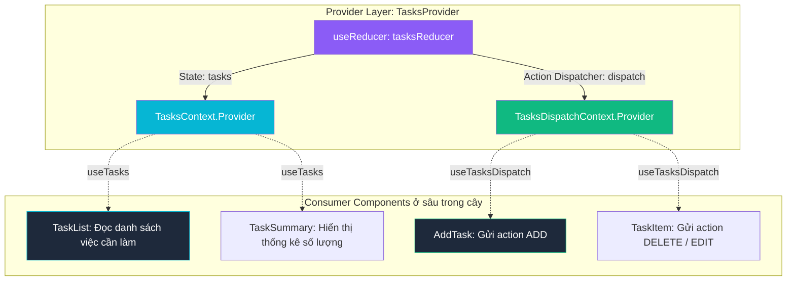

# **CHƯƠNG 3: MANAGING STATE (QUẢN LÝ TRẠNG THÁI)**
# **BÀI HỌC 23: SCALING UP WITH REDUCER AND CONTEXT (MỞ RỘNG QUY MÔ VỚI REDUCER VÀ CONTEXT)**

> **Hành trình: Zero to Hero React**  
> **Chủ đề:** Bộ đôi kiến trúc tối thượng: Kết hợp `useReducer` và `useContext` thành giải pháp quản lý State toàn cục độc lập (Mini-Redux/Zustand tích hợp sẵn); Kỹ thuật Tách biệt State Context và Dispatch Context chống Re-render hàng loạt; Đóng gói Clean Code với Custom Provider và Custom Hooks (`useTasks`, `useTasksDispatch`); Nâng cấp cùng `useImmerReducer`; Ma trận so sánh Reducer+Context vs Redux Toolkit vs Zustand.  
> **Tài liệu tham khảo chính thức:** [React.dev - Scaling Up with Reducer and Context](https://react.dev/learn/scaling-up-with-reducer-and-context)

---

## 🌟 TỔNG QUAN BÀI HỌC

Trong hai bài học trước, chúng ta đã chinh phục 2 vũ khí quan trọng nhất của quản lý State:
1. **`useReducer` (Bài 21):** Đóng vai trò như **"Bếp trưởng"**, chịu trách nhiệm tập trung toàn bộ logic cập nhật state phức tạp vào một hàm duy nhất.
2. **`useContext` (Bài 22):** Đóng vai trò như **"Cổng dịch chuyển tức thời" (Teleportation)**, truyền dữ liệu từ ngọn cây xuống nút lá sâu mà không cần đào giếng (Prop Drilling).

Tuy nhiên, khi đứng riêng lẻ:
* Nếu chỉ dùng `useReducer`: Bạn vẫn phải **truyền `tasks` và hàm `dispatch` thủ công** qua hàng loạt component trung gian bằng props!
* Nếu chỉ dùng `useContext` với `useState`: Khi logic state phình to, component Provider sẽ ngập ngụa hàng chục hàm xử lý (`handleAddTask`, `handleEditTask`, `handleDeleteTask`...), code trở nên rối rắm.

> [!TIP]
> **Bộ đôi hoàn hảo (The Perfect Match):**  
> Khi kết hợp **`useReducer` + `useContext`**, bạn tạo ra một kiến trúc quản lý State toàn cục mạnh mẽ tương đương các thư viện bên thứ ba như Redux hay Zustand, nhưng hoàn toàn **zero-dependency (không cần cài thêm thư viện nào)**!

---

## 1. SƠ ĐỒ KIẾN TRÚC: KẾT HỢP REDUCER VÀ CONTEXT



### Phân công trách nhiệm rõ ràng:
* **`useReducer`:** Quản lý **cách State thay đổi** (Cách nấu ăn trong bếp).
* **`useContext`:** Quản lý **việc phân phối State và dispatch** đến đúng component con cần nó (Băng chuyền thức ăn ra bàn).

---

## 2. QUY TRÌNH 3 BƯỚC TRIỂN KHAI CHUẨN MỰC

### Bước 1: Tạo 2 Context riêng biệt (State Context & Dispatch Context)

> [!IMPORTANT]
> **Quy tắc vàng của Senior Developer:**  
> **LUÔN LUÔN TÁCH THÀNH 2 CONTEXTS**, không bao giờ gộp chung thành `createContext({ tasks, dispatch })`!  
> * `TasksContext`: Cung cấp danh sách công việc hiện tại.
> * `TasksDispatchContext`: Cung cấp hàm `dispatch` để component con gửi tín hiệu.

```jsx
// TasksContext.js
import { createContext } from 'react';

export const TasksContext = createContext(null);
export const TasksDispatchContext = createContext(null);
```

### Bước 2: Đặt State và Dispatch vào Provider

Tại component cha hoặc Provider bao bọc, ta khởi tạo `useReducer` và bọc cả 2 Provider lồng nhau:

```jsx
import { useReducer } from 'react';
import { TasksContext, TasksDispatchContext } from './TasksContext';

export function TasksProvider({ children }) {
  const [tasks, dispatch] = useReducer(tasksReducer, initialTasks);

  return (
    <TasksContext.Provider value={tasks}>
      <TasksDispatchContext.Provider value={dispatch}>
        {children}
      </TasksDispatchContext.Provider>
    </TasksContext.Provider>
  );
}
```

### Bước 3: Tiêu thụ Context ở bất cứ đâu trong cây Component

* Component cần **đọc dữ liệu** (như `TaskList`): Gọi `useContext(TasksContext)`.
* Component chỉ cần **bắn action** (như nút `AddTask` hoặc nút `Delete`): Gọi `useContext(TasksDispatchContext)`.

```jsx
// AddTask.jsx: Chỉ cần dispatch, KHÔNG CẦN tasks
import { useState, useContext } from 'react';
import { TasksDispatchContext } from './TasksContext';

export default function AddTask() {
  const [text, setText] = useState('');
  const dispatch = useContext(TasksDispatchContext);

  function handleAdd() {
    dispatch({ type: 'added', id: Date.now(), text });
    setText('');
  }

  return (
    <div>
      <input value={text} onChange={(e) => setText(e.target.value)} />
      <button onClick={handleAdd}>Thêm công việc</button>
    </div>
  );
}
```

---

## 3. VÌ SAO PHẢI TÁCH THÀNH 2 CONTEXT? (BÍ MẬT TỐI ƯU HIỆU NĂNG)

Hãy so sánh hai cách làm sau trong phỏng vấn kỹ thuật:

### Cách 1 (Sai lầm phổ biến): Gộp chung vào 1 Context
```jsx
// ❌ CÁCH GỘP CHUNG (ANTI-PATTERN)
const TasksAppContext = createContext(null);

<TasksAppContext.Provider value={{ tasks, dispatch }}>
  <AddTask />
  <TaskList />
</TasksAppContext.Provider>
```
* **Hậu quả:** Mỗi khi `tasks` thay đổi (thêm việc, xoá việc, đánh dấu tick hoàn thành), một object `{ tasks, dispatch }` mới được tạo ra.
* Component `<AddTask />` chỉ muốn lấy hàm `dispatch`, nhưng vì nó gọi `useContext(TasksAppContext)` nên **nó bị ÉP BUỘC re-render theo** mỗi khi có bất kỳ thay đổi nào trong `tasks`!

### Cách 2 (Chuẩn Senior): Tách rời State và Dispatch
* **Bản chất của `dispatch` trong React:** Hàm `dispatch` trả về từ `useReducer` **được React đảm bảo tính ổn định danh tính (stable identity)** — nó không bao giờ thay đổi giữa các lần render!
* Khi tách ra `TasksDispatchContext`, giá trị của nó luôn giữ nguyên.
* Kết quả: Component `<AddTask />` chỉ lắng nghe `TasksDispatchContext` sẽ **hoàn toàn KHÔNG bị re-render** khi danh sách `tasks` thay đổi!

---

## 4. MẪU THIẾT KẾ CLEAN CODE: ĐÓNG GÓI TOÀN BỘ VÀO 1 FILE

Để tránh rác code ở `App.jsx`, chuẩn mực của các dự án lớn là gom Reducer, Contexts, Provider và Custom Hooks vào chung **1 file duy nhất**: `TasksContext.jsx`.

```jsx
// src/context/TasksContext.jsx
import { createContext, useContext, useReducer } from 'react';

const TasksContext = createContext(null);
const TasksDispatchContext = createContext(null);

export function TasksProvider({ children }) {
  const [tasks, dispatch] = useReducer(tasksReducer, initialTasks);

  return (
    <TasksContext.Provider value={tasks}>
      <TasksDispatchContext.Provider value={dispatch}>
        {children}
      </TasksDispatchContext.Provider>
    </TasksContext.Provider>
  );
}

// Custom Hook 1: Đọc State với cơ chế phòng vệ (Defensive Guard)
export function useTasks() {
  const context = useContext(TasksContext);
  if (context === null) {
    throw new Error('useTasks phải được sử dụng bên trong <TasksProvider>!');
  }
  return context;
}

// Custom Hook 2: Bắn Action với cơ chế phòng vệ
export function useTasksDispatch() {
  const context = useContext(TasksDispatchContext);
  if (context === null) {
    throw new Error('useTasksDispatch phải được sử dụng bên trong <TasksProvider>!');
  }
  return context;
}

// Khởi tạo state ban đầu
const initialTasks = [
  { id: 1, text: 'Học React Context API', done: true },
  { id: 2, text: 'Làm chủ useReducer', done: true },
  { id: 3, text: 'Mở rộng quy mô với Reducer + Context', done: false },
];

// Hàm Reducer xử lý nghiệp vụ
function tasksReducer(tasks, action) {
  switch (action.type) {
    case 'added': {
      return [...tasks, { id: action.id, text: action.text, done: false }];
    }
    case 'changed': {
      return tasks.map((t) => (t.id === action.task.id ? action.task : t));
    }
    case 'deleted': {
      return tasks.filter((t) => t.id !== action.id);
    }
    default: {
      throw Error('Unknown action: ' + action.type);
    }
  }
}
```

### Nhìn xem `App.jsx` trở nên gọn gàng và sang trọng như thế nào:
```jsx
// App.jsx
import { TasksProvider } from './context/TasksContext';
import AddTask from './components/AddTask';
import TaskList from './components/TaskList';

export default function App() {
  return (
    <TasksProvider>
      <h1>Quản Lý Dự Án</h1>
      <AddTask />
      <TaskList />
    </TasksProvider>
  );
}
```

---

## 5. NÂNG CẤP VỚI THƯ VIỆN IMMER (`useImmerReducer`)

Nếu mảng hoặc object của bạn có nhiều tầng lồng nhau, bạn có thể thay thế `useReducer` bằng `useImmerReducer` từ thư viện `use-immer`:

```jsx
import { useImmerReducer } from 'use-immer';

export function TasksProvider({ children }) {
  const [tasks, dispatch] = useImmerReducer(tasksImmerReducer, initialTasks);
  // ...
}

function tasksImmerReducer(draft, action) {
  switch (action.type) {
    case 'added':
      draft.push({ id: action.id, text: action.text, done: false });
      break;
    case 'changed': {
      const index = draft.findIndex((t) => t.id === action.task.id);
      draft[index] = action.task;
      break;
    }
    case 'deleted': {
      return draft.filter((t) => t.id !== action.id);
    }
  }
}
```

---

## 6. MA TRẬN SO SÁNH: REDUCER+CONTEXT VS REDUX TOOLKIT VS ZUSTAND

| Tiêu Chí Đánh Giá | `useReducer` + `useContext` | Zustand | Redux Toolkit (RTK) |
| :--- | :--- | :--- | :--- |
| **Cài đặt thư viện** | **Zero-dependency** (Có sẵn trong React) | Cần cài `zustand` (~1.5kB) | Cần cài `@reduxjs/toolkit` & `react-redux` |
| **Boilerplate Setup** | Rất ít, chỉ 1 file Provider | Cực kỳ ít (Chỉ tạo 1 hook `create()`) | Trung bình (Tạo Slice, Configure Store) |
| **Phạm vi State** | Gắn liền theo cây Component (Subtree) | Toàn cầu (Global Module Store) | Toàn cầu (Single Root Store) |
| **Hiệu năng Re-render** | Dễ bị re-render nếu không tách Context | **Tuyệt vời** (Fine-grained Selectors) | **Tuyệt vời** (`useSelector` shallow equal) |
| **Hỗ trợ Async/Thunk** | Phải tự xử lý trong component | Tích hợp sẵn trong actions | RTK Query / `createAsyncThunk` mạnh mẽ |
| **Phù hợp nhất khi** | Ứng dụng vừa, Module độc lập, Design System | Đa số dự án Startup, Mid-to-Large React Apps | Ứng dụng Enterprise ngân hàng, thương mại lớn |

---

## 7. CÂU HỎI PHỎNG VẤN SENIOR FRONTEND ENGINEER

### Q1: Tại sao React không tích hợp sẵn bộ chọn Selector (như `useContextSelector`) cho Context API?
> **Trả lời:**  
> Context API được thiết kế ban đầu cho **dữ liệu ít biến động** (Low-frequency updates) như Theme, Locale, User Session. Khi bạn dùng cho dữ liệu biến động nhanh (High-frequency state), việc thiếu Fine-grained selector khiến toàn bộ component lắng nghe Context đều phải chạy lại.  
> Do đó, kiến trúc chuẩn là:
> 1. **Tách Contexts:** Tách riêng State Context và Dispatch Context.
> 2. **Chỉ dùng Reducer+Context cho từng phân vùng tính năng** (Feature-scoped), không nên tạo một "God Context" cho toàn bộ app.

### Q2: Sự khác biệt lớn nhất giữa Redux Store và Reducer + Context là gì?
> **Trả lời:**  
> 1. **Tính cục bộ (Locality):** Redux Store là một **Singleton toàn cục** độc lập với React. Còn Reducer + Context sống bên trong cây React Component. Nếu bạn unmount `<TasksProvider>`, toàn bộ state bên trong bị hủy theo vòng đời React.
> 2. **Khả năng tái sử dụng (Reusability):** Bạn có thể bọc hai thẻ `<TasksProvider>` ở hai trang khác nhau để có 2 danh sách việc làm hoàn toàn độc lập mà không sợ xung đột state! Với Redux, bạn phải cấu hình key động phức tạp hơn nhiều.